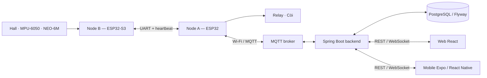

# Smart Motorbike Guardian

Hệ thống IoT bảo vệ và giám sát mô hình xe máy trên breadboard. Hai node ESP32 thu nhận chuyển động, tốc độ bánh và vị trí GPS; backend lưu dữ liệu và phân quyền; web/mobile hiển thị trạng thái, cảnh báo và gửi lệnh điều khiển có xác nhận.

## Chức năng

- Bật/tắt bảo vệ; phát hiện rung lắc hoặc bánh quay khi đang bảo vệ.
- Nhận diện dấu hiệu nghiêng/ngã theo ngưỡng cảm biến MPU-6050; gửi cảnh báo để người dùng kiểm tra.
- Đo tốc độ bằng Hall, thống kê quãng đường quy đổi và tốc độ cao nhất theo phiên.
- Chỉnh ngưỡng cảnh báo tốc độ trên web/mobile; Node A xác nhận và lưu cấu hình sau mất điện.
- Định vị NEO-6M; phân biệt vị trí mới, vị trí lần cuối và chưa định vị được.
- Điều khiển relay/còi; từ chối ARM/LOCK khi bánh chưa dừng hoặc dữ liệu không đủ mới.
- Owner/Viewer/Admin, lịch sử lệnh và cảnh báo, REST/WebSocket realtime, lịch sử telemetry và CSV.

## Kiến trúc



Node B đọc cảm biến độc lập với kết nối mạng. Node A quyết định trạng thái bảo vệ và đầu ra tại chỗ. Backend kiểm tra quyền người dùng; firmware kiểm tra điều kiện thiết bị trước thực thi. Ứng dụng không coi việc gửi lệnh là đã thực hiện.

## Cấu trúc repository

```text
README.md
.env.example
firmware/       # Node A, Node B và sketch kiểm tra GPS
backend/        # API, MQTT, telemetry, quyền và lệnh
frontend/       # Web React; mobile nằm trong frontend/mobile/
database/       # Hướng dẫn schema/migration và dữ liệu mẫu
deployment/     # Docker Compose, broker và bộ chạy cục bộ
hardware/       # Sơ đồ đấu nối, linh kiện và hình minh họa
tests/          # Kiểm thử firmware, tích hợp và kiểm tra phát hành
docs/           # Báo cáo, slide, thiết kế và hướng dẫn
```

Các dotfile Git/CI hỗ trợ kiểm tra mã nguồn. Dependencies, cấu hình riêng, database chạy thật, build output và bản nháp không thuộc bản phát hành.

## Cài đặt và chạy bằng Docker

Cần Git, Docker và Docker Compose. Clone repository, tạo cấu hình local từ mẫu:

```powershell
git clone https://github.com/hieupham03/smart-motorbike-guardian.git
cd smart-motorbike-guardian
Copy-Item .env.example deployment/.env
```

Điền `POSTGRES_PASSWORD`, `JWT_SECRET` (ít nhất 32 ký tự ngẫu nhiên) và `DEMO_PASSWORD` nếu bật dữ liệu mẫu. Mật khẩu do người chạy tự đặt; repository không cung cấp mật khẩu chung.

```powershell
docker compose --env-file deployment/.env -f deployment/docker-compose.yml up --build -d
```

- Web: **http://localhost:3000**
- Backend health: **http://localhost:8080/api/health**
- OpenAPI: **http://localhost:8080/swagger-ui.html**
- Khi bật seed, tài khoản mẫu: `owner@guardian.iot`; dùng mật khẩu đã đặt trong `DEMO_PASSWORD`.

Mặc định dùng broker công cộng cho mô hình. Có thể chạy profile `local-broker`; backend và Node A phải cùng broker/topic. Xem [triển khai](deployment/README.md).

## Chạy cục bộ và mobile

Cần JDK 17+, Maven, Node.js 22.13+ và npm. Bộ chạy trên Windows có thể dùng H2 file, không cần Docker:

```powershell
cd backend
mvn package
cd ../frontend
npm ci
cd mobile
npm ci
cd ../..
.\deployment\start-mobile-demo.bat
```

Bộ chạy tạo cấu hình riêng ở `.local/`, hỏi mật khẩu trong lần đầu và dùng backend cổng **8082**, Expo cổng **8081**. Điện thoại và máy tính cần cùng mạng và truy cập được backend. Để mở web với cùng backend, dùng terminal khác:

```powershell
cd frontend
$env:BACKEND_URL = 'http://127.0.0.1:8082'
npm run dev
```

Web cục bộ: **http://localhost:5173**. [Hướng dẫn mobile](frontend/mobile/README.md) phân biệt Expo Go, development build và APK preview. Remote push cần native build cùng cấu hình EAS/FCM/APNs; cài Expo Go không xác nhận tính năng này.

## Phần cứng và firmware

Đọc [sơ đồ đấu nối](hardware/SO-DO-DAU-NOI-PHAN-CUNG.md) và [hướng dẫn nạp](docs/HUONG-DAN-HARDWARE-FIRMWARE-V2-GPS.md). Firmware chuẩn chỉ nằm tại `firmware/node_a_gateway/` và `firmware/node_b_sensor/`. Tạo `network_config.h` local từ file mẫu của Node A, điền Wi-Fi riêng; file thật được loại khỏi Git.

Node A bật nguồn motor theo cấu hình khởi động. Tắt nhánh nguồn motor khi nạp, thay dây hoặc kiểm tra nguồn. Cảnh báo tốc độ không tự giảm tốc/khóa xe. Mô hình không phải thiết bị an toàn hoặc chống trộm thương mại cho xe thật.

## Kiểm thử và tài liệu

- [Kiểm thử phần mềm](tests/README.md), [kiểm tra hardware](docs/NGHIEM-THU-HARDWARE-FIRMWARE.md), [kiểm tra mobile](docs/NGHIEM-THU-MOBILE-TRUC-TIEP.md).
- [Đổi ngưỡng tốc độ](docs/CAI-DAT-NGUONG-TOC-DO-WEB-MOBILE.md), [chạy web/mobile với mạch](docs/CHAY-WEB-MOBILE-VOI-PHAN-CUNG-THAT.md).
- [Báo cáo, slide và thiết kế](docs/README.md), [hồ sơ phát hành](docs/RELEASE.md), [quy tắc repository](docs/REPOSITORY-POLICY.md).

Lịch sử commit giữ đóng góp của từng tài khoản thành viên; mỗi người tiếp tục commit/push bằng tài khoản của mình. Tag `v1.0.0` xác định snapshot bàn giao. Kết quả kiểm thử phần mềm, xác nhận của người vận hành và các ca native/phần cứng chưa nghiệm thu được ghi riêng trong [hồ sơ phát hành](docs/RELEASE.md). Xem [đối chiếu điều kiện đồ án](docs/DOI-CHIEU-DIEU-KIEN-DO-AN.md) để chuẩn bị demo và vấn đáp.
