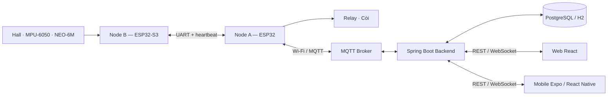

# Smart Motorbike Guardian

Hệ thống IoT bảo vệ và giám sát mô hình xe máy trên breadboard. Hai node ESP32 thu nhận chuyển động, tốc độ bánh và vị trí GPS; backend Spring Boot xử lý dữ liệu, quản lý vòng đời thiết bị và phân quyền; ứng dụng Web (React) và Mobile (Expo / React Native) hiển thị trạng thái thời gian thực, cảnh báo và gửi lệnh điều khiển có xác nhận (ACK).

## Tính năng chính

- **Bảo vệ chống trộm:** Bật/tắt chế độ canh giữ (`ARM`/`DISARM`); phát hiện rung lắc (MPU-6050) hoặc bánh quay (Hall) khi đang canh giữ và kích hoạt còi/báo động.
- **Nhận diện nghiêng/ngã:** Phát hiện dấu hiệu nghiêng/ngã theo ngưỡng góc và thời gian trên MPU-6050, gửi cảnh báo để người dùng kiểm tra.
- **Đo tốc độ và phiên quay bánh:** Đo tốc độ bằng cảm biến Hall, thống kê số xung, số vòng, quãng đường quy đổi và tốc độ tối đa theo phiên.
- **Cấu hình ngưỡng cảnh báo tốc độ từ xa:** Chỉnh ngưỡng (1–120 km/h) trực tiếp trên Web/Mobile; Node A xác nhận (ACK) và lưu bền vững vào NVS.
- **Định vị GPS NEO-6M:** Phân biệt rõ trạng thái có vị trí mới (`FIX`), giữ vị trí hợp lệ gần nhất (`STALE`) và chưa định vị (`NO_FIX`).
- **Điều khiển an toàn có interlock:** Điều khiển relay/còi (`LOCK_ENGINE`, `UNLOCK_ENGINE`, `SIREN_ON`, `SIREN_OFF`); firmware từ chối `ARM`/`LOCK_ENGINE` khi bánh chưa dừng hoặc dữ liệu cảm biến quá hạn.
- **Quản lý người dùng & bảo mật:** Phân quyền `Owner` / `Viewer` / `Admin` (JWT + BCrypt), kích hoạt thiết bị bằng mã một lần, lịch sử lệnh/cảnh báo, cập nhật realtime (REST + STOMP WebSocket), biểu đồ telemetry và xuất CSV.
- **Xác thực MQTT theo thiết bị:** Broker nội bộ có mật khẩu riêng cho từng UUID (BCrypt), phân quyền ACL theo topic và ngắt phiên tức thì khi thu hồi thiết bị; giao diện web demo hỗ trợ HTTPS/WSS với chứng chỉ cục bộ.

## Kiến trúc hệ thống



- **Node B** đọc cảm biến độc lập với kết nối mạng và truyền khung dữ liệu có checksum qua UART cho Node A.
- **Node A** quyết định trạng thái bảo vệ, kiểm tra điều kiện an toàn trước khi xuất relay/còi và phản hồi ACK qua MQTT.
- **Backend** kiểm tra xác thực, quyền sở hữu, lưu trữ lịch sử và phân phối sự kiện realtime; ứng dụng chỉ xác nhận lệnh thành công sau khi nhận ACK từ thiết bị.

## Cấu trúc repository

```text
smart-motorbike-guardian/
├── README.md
├── .env.example        # Mẫu biến môi trường (không chứa mật khẩu thật)
├── firmware/           # Mã nguồn Node A, Node B và sketch kiểm tra GPS
├── backend/            # Spring Boot API, MQTT broker/client, Flyway, bảo mật
├── frontend/           # Web React (Vite) và Mobile Expo trong frontend/mobile/
├── database/           # Hướng dẫn Flyway migration và dữ liệu mẫu
├── deployment/         # Docker Compose, cấu hình Mosquitto và script khởi chạy
├── hardware/           # Sơ đồ đấu nối breadboard, linh kiện và hình minh họa
├── tests/              # Kiểm thử firmware, tích hợp giao diện và kiểm tra repo
└── report/             # Báo cáo cuối cùng, slide thuyết trình, thiết kế và minh chứng
```

## Yêu cầu môi trường

- **Chạy bằng Docker (khuyến nghị):** Git, Docker và Docker Compose.
- **Chạy cục bộ (không cần Docker):** JDK 17+, Maven 3.9+, Node.js 22.13+ (hoặc 24+) và npm.
- **Chạy chế độ Classroom HTTPS trên Windows:** Cần thêm OpenSSL trên `PATH` (hoặc `C:\msys64\mingw64\bin\openssl.exe`).

---

## Cách 1: Cài đặt và chạy bằng Docker Compose (Khuyến nghị)

Chế độ này khởi chạy đầy đủ **PostgreSQL 15**, **Spring Boot Backend** và **React Web (Nginx)**.

### Bước 1: Clone repository và tạo file cấu hình `.env`

```powershell
git clone https://github.com/hieupham03/smart-motorbike-guardian.git
cd smart-motorbike-guardian
Copy-Item .env.example deployment/.env
```

*(Trên Linux/macOS dùng `cp .env.example deployment/.env`.)*

### Bước 2: Điền biến môi trường bắt buộc trong `deployment/.env`

Mở `deployment/.env` và điền giá trị do bạn tự chọn cho 3 biến sau (không để trống):

- `POSTGRES_PASSWORD`: mật khẩu PostgreSQL (ví dụ chuỗi ngẫu nhiên ≥ 12 ký tự).
- `JWT_SECRET`: khóa ký JWT ít nhất **32 ký tự ngẫu nhiên**.
- `DEMO_PASSWORD`: mật khẩu cho các tài khoản mẫu (ít nhất **8 ký tự**, dùng khi `DEMO_SEED_ENABLED=true`).

### Bước 3: Khởi chạy hệ thống

```powershell
docker compose --env-file deployment/.env -f deployment/docker-compose.yml up --build -d
```

Sau khi các container khởi động xong:

- **Web App:** http://localhost:3000
- **Backend Health:** http://localhost:8080/api/health
- **Swagger / OpenAPI:** http://localhost:8080/swagger-ui.html
- **Tài khoản mẫu** (khi `DEMO_SEED_ENABLED=true`): `owner@guardian.iot`, `viewer@guardian.iot`, `admin@guardian.iot` — sử dụng mật khẩu đã đặt ở `DEMO_PASSWORD`.

Để dừng hệ thống:

```powershell
docker compose --env-file deployment/.env -f deployment/docker-compose.yml down
```

> **Tùy chọn broker có xác thực trong Docker:** Xem [hướng dẫn triển khai](deployment/README.md) để dùng `deployment/docker-compose.classroom.yml` (broker nội bộ có xác thực từng thiết bị và ACL).

---

## Cách 2: Chạy cục bộ không cần Docker (H2 + Web + Mobile)

### 2A. Chạy phát triển nhanh (Windows / macOS / Linux)

Phù hợp để chạy thử ngay toàn bộ Web và Backend bằng cơ sở dữ liệu H2 trong RAM mà không cần cài PostgreSQL hay OpenSSL.

**Terminal 1 — Khởi chạy Backend (cổng 8080):**

```powershell
# PowerShell (từ thư mục gốc dự án)
$bytes = New-Object byte[] 48
[Security.Cryptography.RandomNumberGenerator]::Create().GetBytes($bytes)
$env:JWT_SECRET = [Convert]::ToBase64String($bytes)
$env:DEMO_SEED_ENABLED = "true"
$env:DEMO_PASSWORD = "ChangeMeDemo123!"   # Tự đặt mật khẩu >= 8 ký tự
$env:SPRING_PROFILES_ACTIVE = "h2"
$env:MQTT_ENABLED = "false"               # Đổi thành "true" khi kết nối broker MQTT thật

cd backend
mvn spring-boot:run
```

Kiểm tra backend sẵn sàng tại **http://localhost:8080/api/health** (`{"status":"UP","database":"UP",...}`).

**Terminal 2 — Khởi chạy Web React (cổng 5173):**

```powershell
cd frontend
npm ci
npm run dev
```

Mở trình duyệt tại **http://localhost:5173** và đăng nhập bằng `owner@guardian.iot` cùng mật khẩu `DEMO_PASSWORD` vừa đặt.

**Terminal 3 — Khởi chạy Mobile Expo (tùy chọn):**

```powershell
cd frontend/mobile
npm ci
Copy-Item .env.example .env
# Sửa EXPO_PUBLIC_API_BASE_URL và EXPO_PUBLIC_WS_URL trong .env thành IP LAN máy tính (hoặc 127.0.0.1 nếu chạy web)
npm start
# Hoặc chạy nhanh bản Mobile Web trên trình duyệt:
npm run web
```

### 2B. Chạy bộ demo Classroom trên Windows (Broker MQTT có xác thực + Web HTTPS + Mobile)

Dùng khi trình diễn cùng mạch ESP32 thật trên mạng LAN (lưu H2 ra file tại `.local/classroom-demo/`, không cần Docker):

```powershell
# 1. Build Backend và Web
cd backend
mvn package
cd ../frontend
npm ci
npm run build
cd mobile
npm ci
cd ../..

# 2. Tạo cấu hình Wi-Fi cho Node A từ file mẫu (điền SSID/password Wi-Fi 2.4 GHz)
Copy-Item firmware/node_a_gateway/network_config.example.h firmware/node_a_gateway/network_config.h

# 3. Khởi chạy Backend (8082) + Broker MQTT có xác thực (1883) + Web HTTPS (5173)
.\deployment\start-classroom-demo.bat -WebOnly
```

- Lần chạy đầu, launcher sẽ yêu cầu đặt mật khẩu cho các tài khoản mẫu và lưu mã hóa cục bộ (Windows DPAPI) trong `.local/classroom-demo/`.
- Mở Web tại **https://localhost:5173** (chấp nhận chứng chỉ tự ký cục bộ sau khi đối chiếu fingerprint).
- Bỏ `-WebOnly` để mở kèm Expo Go (**8081**), hoặc mở mobile sau bằng:

```powershell
.\deployment\start-mobile-client.bat
```

Xem chi tiết quy trình chuẩn bị khóa, nạp Node A và kích hoạt mạch tại [Chuẩn bị demo tại trường](report/CHUAN-BI-DEMO-TAI-TRUONG.md) và [Hướng dẫn mobile](frontend/mobile/README.md).

---

## Phần cứng và firmware

- Sơ đồ đấu nối chi tiết: [hardware/SO-DO-DAU-NOI-PHAN-CUNG.md](hardware/SO-DO-DAU-NOI-PHAN-CUNG.md)
- Hướng dẫn thư viện, nạp board và kiểm tra: [report/HUONG-DAN-HARDWARE-FIRMWARE-GPS.md](report/HUONG-DAN-HARDWARE-FIRMWARE-GPS.md)
- Mã nguồn chuẩn nằm tại `firmware/node_a_gateway/` (ESP32-WROOM-32) và `firmware/node_b_sensor/` (ESP32-S3 N16R8). Sao chép `firmware/node_a_gateway/network_config.example.h` thành `network_config.h` để cấu hình Wi-Fi cục bộ (file thật được `.gitignore` loại trừ).

> **Lưu ý an toàn:** Tắt nhánh nguồn motor khi nạp firmware, thay dây hoặc kiểm tra nguồn. Cảnh báo quá tốc độ chỉ phát cảnh báo và không tự cắt motor. Hệ thống là mô hình học phần IoT trên breadboard, không phải thiết bị an toàn thương mại cho xe máy thật.

## Kiểm thử tự động

```powershell
# Kiểm tra cấu trúc repository và liên kết tài liệu
python tests/publication/check_repository.py

# Kiểm thử Backend (Spring Boot, Flyway, MQTT broker tích hợp, phân quyền)
cd backend
mvn verify
cd ..

# Kiểm thử và build Web
cd frontend
npm ci
npm test
npm run build
cd ..

# Kiểm thử Mobile (TypeScript, ESLint, Jest)
cd frontend/mobile
npm ci
npm run typecheck
npm run lint
npm test -- --watch=false
cd ../..
```

Chi tiết các bộ kiểm thử xem tại [tests/README.md](tests/README.md).

## Tài liệu và báo cáo

- **Báo cáo cuối cùng:** [PDF](report/report/technical/BAO-CAO-CUOI-CUNG-SMART-MOTORBIKE-GUARDIAN.pdf) · [Word](report/report/technical/BAO-CAO-CUOI-CUNG-SMART-MOTORBIKE-GUARDIAN.docx) · [Markdown](report/report/technical/BAO-CAO-CUOI-CUNG-SMART-MOTORBIKE-GUARDIAN.md)
- **Slide thuyết trình:** [PowerPoint](report/slides/Smart-Motorbike-Guardian.pptx) · [PDF](report/slides/Smart-Motorbike-Guardian.pdf) · [Kịch bản trình bày & vấn đáp](report/KICH-BAN-DEMO-VA-VAN-DAP.md)
- **Hướng dẫn vận hành:** [Đổi ngưỡng tốc độ](report/CAI-DAT-NGUONG-TOC-DO-WEB-MOBILE.md) · [Chạy Web/Mobile với mạch thật](report/CHAY-WEB-MOBILE-VOI-PHAN-CUNG-THAT.md) · [Xác thực MQTT & vòng đời thiết bị](report/BAO-MAT-MQTT-VA-VONG-DOI.md)
- **Tổng hợp kiểm chứng & tài liệu:** [Hồ sơ sản phẩm & kiểm chứng](report/RELEASE.md) · [Danh mục tài liệu](report/README.md)
