<!-- COVER -->
# BÁO CÁO ĐỒ ÁN KẾT THÚC HỌC PHẦN

## Học phần: IoT và ứng dụng

## SMART MOTORBIKE GUARDIAN

### Hệ thống bảo vệ, giám sát và cảnh báo sự cố xe máy

Trường: ........................................................................................

Khoa/Bộ môn: ...............................................................................

Giảng viên hướng dẫn: ...................................................................

Lớp học phần: .................................... Nhóm: ................................

Sinh viên thực hiện: theo bảng thông tin nhóm.

**BÁO CÁO TỔNG KẾT NGUYÊN MẪU IoT**

Mã nguồn: https://github.com/hieupham03/smart-motorbike-guardian

<!-- PAGE -->


# 2. THÔNG TIN NHÓM VÀ BẢNG PHÂN CÔNG CÔNG VIỆC

**Bảng 1. Thành viên và trách nhiệm kỹ thuật.**

| Thành viên | Họ tên / mã sinh viên | Nội dung phụ trách |
|---|---|---|
| TV1 | .................................. | Phần cứng, firmware, cảm biến, xử lý tại biên và đầu ra |
| TV2 | .................................. | MQTT, backend, cơ sở dữ liệu và triển khai |
| TV3 | .................................. | Xử lý dữ liệu IoT, realtime, cảnh báo và web |
| TV4 | .................................. | Điều khiển hai chiều, phân quyền, thông báo và mobile |

TV1 và TV2 thống nhất bản tin UART/MQTT; TV2, TV3 và TV4 thống nhất API và sự kiện realtime. Mỗi người phụ trách thiết kế, triển khai, kiểm thử và viết nội dung của khối mình. Cả nhóm cùng kiểm tra hai luồng: cảm biến đến ứng dụng và lệnh từ ứng dụng đến thiết bị.

Các thành viên phối hợp kiểm thử tại ranh giới giữa thiết bị, backend và ứng dụng. Mỗi người chịu trách nhiệm giải thích thiết kế và kết quả của phần mình phụ trách.

<!-- PAGE -->

# 3. TÓM TẮT ĐỒ ÁN

Smart Motorbike Guardian là nguyên mẫu bảo vệ và giám sát xe máy trên breadboard. Hệ thống phát hiện rung hoặc bánh quay khi bật bảo vệ, nhận biết dấu hiệu nghiêng/ngã, theo dõi tốc độ và hiển thị vị trí GPS. Chủ xe theo dõi cảnh báo, lịch sử và gửi lệnh trên web hoặc mobile.

Node B dùng ESP32-S3 N16R8 để đọc Hall, MPU-6050 và NEO-6M. Node A nhận dữ liệu qua UART, điều khiển relay/còi và kết nối backend bằng Wi-Fi/MQTT. Backend lưu dữ liệu, kiểm quyền và chuyển cập nhật đến ứng dụng. Lệnh điều khiển có mã định danh, kết quả thực thi và lý do từ chối.

Kết quả kiểm thử cho thấy các thành phần phần mềm phối hợp được trong luồng giám sát, cảnh báo và điều khiển. Hệ thống minh họa đầy đủ các tầng của một ứng dụng IoT, từ cảm biến đến giao diện người dùng. Thuật toán nhận biết dấu hiệu ngã được xây dựng theo ngưỡng và thời gian, phù hợp với thử nghiệm trên mô hình breadboard.[^ai-content]

<!-- PAGE -->

## MỤC LỤC

<!-- TOC -->

<!-- PAGE -->

## DANH MỤC HÌNH

<!-- FIGURES -->

## DANH MỤC BẢNG

<!-- TABLES -->

<!-- PAGE -->

# 4. GIỚI THIỆU BÀI TOÁN

## 4.1. Vấn đề và căn cứ

Đề tài tập trung vào ba nhu cầu của chủ xe: nhận biết tác động trái phép khi đỗ xe, nhận cảnh báo khi có dấu hiệu ngã và theo dõi đúng tình trạng xe từ xa.

**Bảo vệ xe khi chủ xe không ở gần.** Vụ án được Bộ Công an công bố cho thấy xe tại chung cư, dãy trọ và nhà hàng có thể bị nhắm đến, với thao tác phá khóa diễn ra trong thời gian ngắn [21]. Tình huống này đặt ra nhu cầu nhận biết xe bị tác động và báo cho chủ xe. Trong mô hình, rung bất thường và bánh quay khi bật bảo vệ là hai dấu hiệu được sử dụng để phát cảnh báo.

**Thông báo khi xe có dấu hiệu ngã.** WHO xác định người đi xe máy thuộc nhóm dễ bị tổn thương và nhấn mạnh vai trò của chăm sóc kịp thời sau va chạm [22]. Đề tài tiếp cận nhu cầu này bằng cách phát hiện tư thế nghiêng kéo dài, kết hợp tốc độ bánh xe để tạo cảnh báo. Thông tin giúp người theo dõi kiểm tra tình huống; hệ thống không tự kết luận tai nạn hoặc gọi cứu hộ.

**Theo dõi đúng trạng thái xe và kết quả điều khiển.** Việc vận hành mô hình ghi nhận GPS có thể mất định vị khi đưa vào nhà; kiểm thử phần mềm cũng bao gồm mất kết nối và lệnh bị từ chối [2]. Nếu chỉ hiển thị giá trị cuối cùng, người dùng dễ hiểu nhầm đó là tình trạng đang diễn ra. Vì vậy, ứng dụng phân biệt vị trí mới với vị trí gần nhất và chỉ báo lệnh thành công sau khi nhận kết quả từ thiết bị.

## 4.2. Mục tiêu giải quyết vấn đề

Mục tiêu của đề tài là xây dựng hệ thống hỗ trợ chủ xe phát hiện tác động bất thường, nhận cảnh báo sự cố và theo dõi xe từ xa. Mỗi mục tiêu được đánh giá qua kết quả quan sát trong các tình huống sử dụng.

**Bảng 2. Liên hệ vấn đề, mục tiêu và tiêu chí đánh giá.**

| Vấn đề | Mục tiêu của hệ thống | Tiêu chí đánh giá |
|---|---|---|
| Tác động trái phép khi đỗ | Giúp chủ xe nhận biết và kiểm tra sự kiện khi bật bảo vệ | Tác động đủ điều kiện tạo cảnh báo; lưu lịch sử và cập nhật ứng dụng |
| Dấu hiệu ngã khi sử dụng | Chuyển dấu hiệu nghiêng kéo dài thành thông tin cần kiểm tra | Thử đúng ngưỡng/thời gian; cảnh báo có loại sự kiện và thời điểm |
| Thông tin/lệnh không còn tin cậy | Giúp người dùng nhận biết dữ liệu cũ và kết quả điều khiển | Hiển thị NO_FIX/STALE; lệnh có ACK/timeout; từ chối người không có quyền và lệnh chưa đủ điều kiện |

Phần kiểm thử ở mục 15 đối chiếu các tiêu chí này với kết quả phần mềm và hồ sơ vận hành mô hình.

## 4.3. Phạm vi và điểm đóng góp

Đối tượng sử dụng là chủ xe, người được chia sẻ quyền theo dõi và quản trị viên. Thiết bị chạy trên breadboard với bánh xe đường kính 6,5 cm, motor nhỏ, relay và cảm biến. Phạm vi giám sát từ xa phụ thuộc kết nối Wi-Fi của Node A; mô hình không tích hợp modem di động.

Định vị và cảnh báo chuyển động đã có trong các sản phẩm thương mại [23][24]. Đề tài vận dụng các chức năng này trong một hệ thống IoT do nhóm xây dựng, bổ sung quản lý thiết bị, phân quyền, lịch sử và phản hồi điều khiển. Giá trị của đồ án nằm ở sự phối hợp giữa các tầng và khả năng giải thích, kiểm chứng toàn bộ luồng hoạt động.

# 5. KHẢO SÁT YÊU CẦU

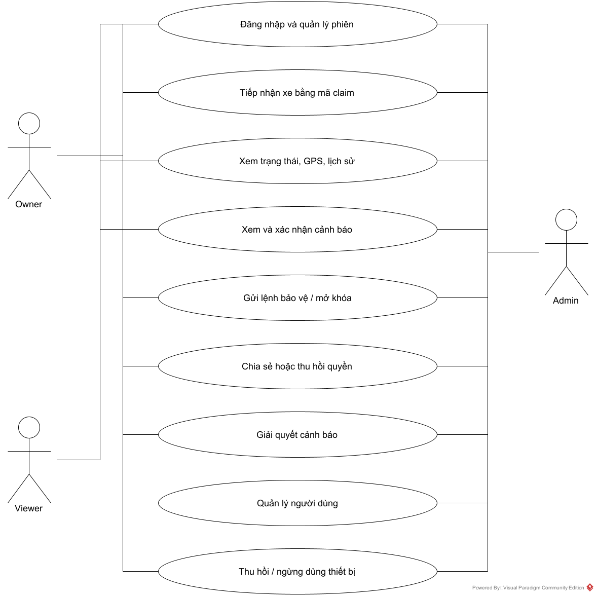

Yêu cầu hệ thống được tổng hợp từ đề bài học phần [1], nguồn thứ cấp, tài liệu sản phẩm và quá trình thử mô hình. Phương pháp khảo sát là phân tích tài liệu và tình huống sử dụng.

**Bảng 3. Yêu cầu và kết quả cần quan sát.**

| Mã | Yêu cầu | Kết quả cần quan sát |
|---|---|---|
| YC01 | Bật/tắt bảo vệ | Trạng thái được đồng bộ; bật bảo vệ chỉ khi bánh dừng và dữ liệu mới |
| YC02 | Nhận biết rung và bánh quay khi bảo vệ | Cảnh báo đúng loại, có thời điểm và lịch sử |
| YC03 | Theo dõi dấu hiệu ngã và quá tốc độ | Cảnh báo theo ngưỡng/thời gian; không tự điều tốc motor |
| YC04 | Theo dõi vị trí và độ mới | Vị trí có trạng thái hợp lệ; không tạo tọa độ khi chưa có fix |
| YC05 | Điều khiển từ xa | Có mã lệnh, ACK, lý do từ chối hoặc timeout |
| YC06 | Quản lý người dùng/thiết bị | Phân biệt quyền đọc, điều khiển và quản trị |
| YC07 | Lưu và tra cứu | Có lịch sử cảm biến, cảnh báo, lệnh và audit |
| YC08 | Xử lý mất kết nối | Phát hiện liên kết mất, khôi phục dữ liệu khi nối lại |

Ngoài chức năng, hệ thống phải thể hiện rõ đơn vị, thời gian và độ mới của dữ liệu; kiểm quyền tại backend và tách thông tin bí mật khỏi mã nguồn. Việc mất tín hiệu GPS không được làm gián đoạn Hall và MPU. Các tình huống mất kết nối, từ chối lệnh và phục hồi dữ liệu được đưa vào kiểm thử ở mục 15.

## 5.1. Các tình huống sử dụng chính

### Theo dõi xe từ xa

Chủ xe đăng nhập, chọn một xe trong danh sách được cấp quyền và mở màn hình tổng quan. Ứng dụng lấy thông tin thiết bị cùng dữ liệu gần nhất từ backend, sau đó nhận các thay đổi qua kênh realtime. Người dùng quan sát trạng thái bảo vệ, tốc độ, kết nối cảm biến và vị trí. Mỗi thông tin phải đi kèm khả năng xác định nó còn sử dụng được hay đã cũ. Nếu gateway vẫn liên lạc nhưng GPS mất định vị, ứng dụng vẫn hiển thị các cảm biến còn hợp lệ và ghi rõ tình trạng vị trí.

Khi người dùng mở lịch sử, truy vấn được giới hạn theo xe, khoảng thời gian và quyền truy cập. Dữ liệu trả về là các mẫu được lưu trong khoảng đã chọn. Vì vậy, số đo trên dashboard và biểu đồ lịch sử có vai trò khác nhau: một phần trả lời xe đang ở tình trạng nào, phần còn lại phục vụ xem lại diễn biến. Cách tách này giúp giao diện không phải tải toàn bộ lịch sử chỉ để hiển thị trạng thái mới nhất.

### Bật bảo vệ khi đỗ xe

Người có quyền điều khiển gửi yêu cầu bật bảo vệ sau khi bánh đã dừng. Backend kiểm quyền và tạo bản ghi lệnh; Node A quyết định chấp nhận dựa vào dữ liệu cảm biến. Nếu dữ liệu đã cũ hoặc bánh còn chuyển động, thiết bị trả về lý do từ chối và ứng dụng giữ nguyên trạng thái phù hợp. Khi lệnh được chấp nhận, Node A chuyển sang ARMED, điều chỉnh relay và gửi phản hồi.

Trong chế độ này, hệ thống theo dõi rung bất thường và xung bánh xe. Một sự kiện đủ điều kiện được chuyển thành cảnh báo tại thiết bị rồi gửi về backend. Chủ xe có thể xem loại sự kiện, tình trạng xe và thời điểm ghi nhận trên web hoặc mobile. Việc dừng cảnh báo và thoát bảo vệ sử dụng lệnh tương ứng; ứng dụng không tự thay trạng thái thiết bị chỉ vì người dùng vừa nhấn nút.

### Tiếp nhận dấu hiệu ngã

MPU cung cấp gia tốc theo ba trục để chương trình tính độ nghiêng. Kết quả được đối chiếu với thời gian duy trì và dữ liệu tốc độ theo quy tắc phát hiện. Khi tạo sự kiện, backend lưu cảnh báo và phân phối cho người dùng có quyền. Người theo dõi sử dụng thông tin này để kiểm tra tình huống. Đây là luồng hỗ trợ nhận biết sự cố trên mô hình, không thay cho quy trình xác nhận tai nạn hoặc dịch vụ cứu hộ.

Một yêu cầu quan trọng là phân biệt cơ chế nhận biết sự kiện với cách hiển thị và xử lý cảnh báo. Thiết bị quyết định mẫu nào đủ điều kiện; backend tổ chức lịch sử và quyền; ứng dụng trình bày sự kiện cùng các thao tác xác nhận. Nhờ đó, cùng một sự kiện có ý nghĩa thống nhất trên hai giao diện, thay vì mỗi giao diện tự suy diễn từ dữ liệu cảm biến.

### Điều khiển và theo dõi kết quả

Chủ xe có thể gửi lệnh điều khiển theo các chức năng được firmware hỗ trợ. Lệnh khóa động cơ yêu cầu xác nhận mật khẩu tại backend, sau đó vẫn phải qua điều kiện vận hành của Node A. Một yêu cầu HTTP được chấp nhận chỉ có nghĩa là backend đã tạo lệnh; trạng thái PENDING thể hiện lệnh đang chờ kết quả. EXECUTED và REJECTED đến từ quá trình xử lý, còn TIMEOUT cho biết không nhận được ACK trong giới hạn chờ.

Lịch sử lệnh lưu người gửi, loại lệnh, thiết bị và kết quả. Nếu ACK đến sau khi lệnh đã TIMEOUT, phản hồi được bổ sung vào các trường ACK muộn. Cách lưu này bảo toàn cả thông tin người dùng đã nhìn thấy khi hết hạn chờ lẫn kết quả thiết bị báo về sau đó. Định danh cmd_id cho phép đối chiếu cùng một yêu cầu xuyên qua ứng dụng, backend, MQTT và firmware.

### Chia sẻ và thu hồi quyền theo dõi

Chủ xe có thể chia sẻ quyền xem theo phạm vi dịch vụ. Người theo dõi đọc trạng thái, vị trí và lịch sử của xe được chia sẻ, nhưng không được gửi lệnh điều khiển. Khi quyền bị thu hồi, backend ngừng phân phối sự kiện và ứng dụng loại dữ liệu liên quan. Kiểm quyền được áp dụng cả ở API và kênh realtime; đường dẫn trực tiếp tới một màn hình không tạo thêm quyền sử dụng thiết bị.

# 6. PHÂN TÍCH VÀ LỰA CHỌN GIẢI PHÁP

## 6.1. Sản phẩm liên quan và phạm vi lựa chọn

**Bảng 4. Đối chiếu sản phẩm theo thông tin nhà cung cấp.**

| Sản phẩm | Khả năng được tài liệu công bố | Ý nghĩa với đề tài |
|---|---|---|
| Yamaha Y-Connect [23] | Kết nối xe–điện thoại và lưu vị trí đỗ tại thời điểm ngắt kết nối | Vị trí đỗ đã lưu cần được phân biệt với định vị hiện tại |
| Monimoto [24] | Phát hiện chuyển động, kiểm tra khóa đi kèm, gọi cảnh báo và gửi vị trí tới app | Chống trộm kết hợp định vị đã là hướng thương mại hiện có |
| Nguyên mẫu của nhóm | Hall/MPU/GPS, hai node, quản lý quyền, lịch sử và lệnh có phản hồi | Phù hợp kiểm chứng kiến trúc và luồng IoT trong học phần |

Việc đối chiếu dựa trên những chức năng nhà cung cấp công bố, tập trung vào cách kết nối, phát cảnh báo và hiển thị vị trí. Đây là cơ sở lựa chọn phạm vi đồ án, không phải kết quả đo hoặc xếp hạng các sản phẩm. Phạm vi được chọn phù hợp với linh kiện sẵn có và điều kiện thử trên mô hình.

## 6.2. Các quyết định kỹ thuật

Hệ thống chia công việc cho hai node: Node B thu thập dữ liệu cảm biến và GPS; Node A quản lý trạng thái bảo vệ, đầu ra và kết nối mạng. Cách phân chia giúp tổ chức rõ phần thu nhận và phần điều khiển, đồng thời giảm ảnh hưởng của xử lý mạng đến việc đọc cảm biến. Đổi lại, hai node phải trao đổi và giám sát kết nối qua UART.

Hall được chọn để đo bánh quay trong nhà, nơi GPS có thể chưa có fix. MPU dùng ngưỡng và thời gian vì nhẹ, dễ quan sát và giải thích. GPS cung cấp vị trí độc lập với phép đo tốc độ Hall. Motor được đóng/ngắt bằng relay; hệ thống không có driver PWM để điều tốc.

MQTT dùng cho dữ liệu/lệnh giữa thiết bị và server [3]. REST phục vụ thao tác, cấu hình và lịch sử; STOMP phân phối cập nhật tới người có quyền [6]. Backend và cơ sở dữ liệu riêng cho phép nhóm triển khai quản lý người dùng, thiết bị và audit theo yêu cầu học phần.

<!-- PAGE -->

# 7. KIẾN TRÚC HỆ THỐNG

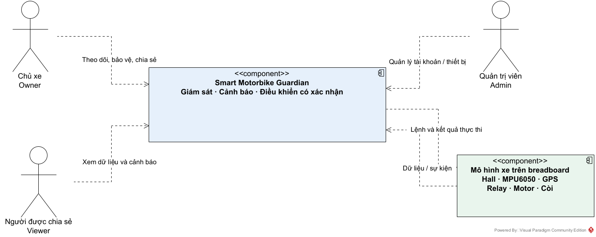

Luồng dữ liệu chính: **Hall/MPU/GPS → Node B → UART → Node A → MQTT → backend → database → web/mobile**. Luồng điều khiển: **ứng dụng → REST → backend → MQTT → Node A → ACK → backend → ứng dụng**. Backend kiểm quyền; firmware kiểm điều kiện thiết bị.

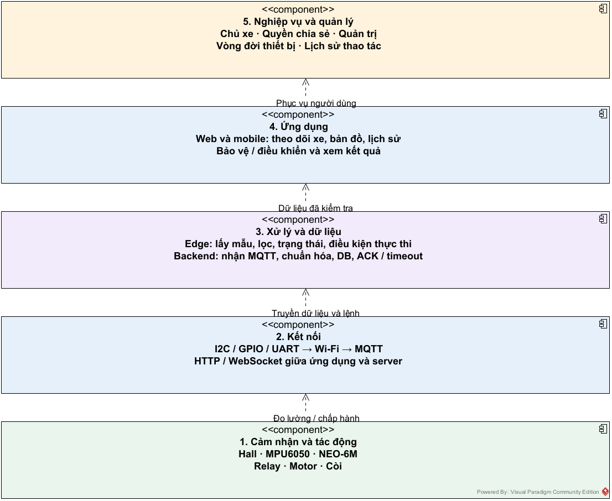

Tầng cảm nhận gồm cảm biến và cơ cấu chấp hành. Tầng mạng gồm UART, Wi-Fi và MQTT. Tầng xử lý gồm xử lý tại biên, backend và lưu trữ. Tầng ứng dụng gồm web/mobile. Tầng nghiệp vụ gắn với bảo vệ, giám sát, chia sẻ quyền và theo dõi sự cố. Các tầng thể hiện trách nhiệm logic, không đòi hỏi năm máy chủ riêng.

Ba loại thông tin được giữ riêng: vòng đời thiết bị, trạng thái bảo vệ và tính hợp lệ của phép đo. Ví dụ, một gateway đang kết nối có thể ở PARKED nhưng GPS chưa có fix. Định danh nội bộ `device_id`, định danh giao tiếp `device_uuid` và mã lệnh `cmd_id` cũng có vai trò riêng; UUID không thay thông tin xác thực.

## 7.1. Phân chia xử lý giữa hai node và các tầng IoT

Hệ thống tổ chức xử lý thành ba phạm vi: thu nhận tại Node B, điều khiển và kết nối mạng tại Node A, quản lý dữ liệu và quyền tại backend. Node B tiếp xúc trực tiếp với Hall, MPU-6050 và GPS, chuyển tín hiệu vật lý thành mẫu đo có đơn vị, thời gian và trạng thái hợp lệ. Node A tiếp nhận mẫu, quyết định cảnh báo và đầu ra, rồi chuyển thông tin sang MQTT. Backend chịu trách nhiệm người dùng, lịch sử và phân phối dữ liệu đến ứng dụng. Cách phân chia này đặt quyết định tại nơi có đủ thông tin: firmware biết bánh có dừng và mẫu có còn mới; backend biết người gửi lệnh có quyền trên xe [2].

Node B dùng UART1 giao tiếp với Node A, UART2 nhận NMEA từ GPS và I2C đọc MPU. Ba đường giao tiếp được phân công riêng, tránh việc đổi cổng hoặc tốc độ của GPS làm thay đổi đường UART giữa hai node. Dữ liệu Hall được ghi nhận bằng ngắt để không phụ thuộc trực tiếp vào thời điểm SensorTask được chạy. GPS được đọc trong tác vụ riêng; việc tìm vệ tinh có thể kéo dài nhưng không chặn việc thu nhận Hall và MPU.

Kiến trúc hai node tạo thêm yêu cầu giám sát liên kết và thống nhất cấu trúc bản tin. Vì vậy, mỗi phép đo đi cùng cờ hợp lệ và thời gian, còn heartbeat giám sát đường giao tiếp. Mất heartbeat, mẫu cảm biến cũ và mất định vị GPS được xử lý riêng. Ví dụ, MPU có thể cung cấp gia tốc trong khi GPS không có vị trí, hoặc Node A vẫn kết nối Wi-Fi nhưng đã mất liên kết cảm biến. Giao diện và điều kiện điều khiển sử dụng các trạng thái thành phần này, thay vì quy mọi tình huống thành một trạng thái “trực tuyến”.

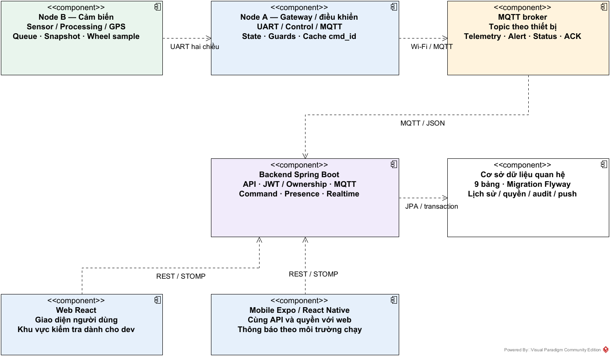

Các adapter giao tiếp chuyển yêu cầu vào cùng nhóm dịch vụ nghiệp vụ. Database giữ lịch sử và quan hệ quyền; các luồng ghi database phát sự kiện sau giao dịch. Snapshot phiên bánh được cập nhật trong RAM rồi phát realtime. Việc phân chia theo trách nhiệm giúp đối chiếu sự kiện từ thiết bị tới người dùng [2].

<!-- PAGE -->

# 8. THIẾT KẾ PHẦN CỨNG

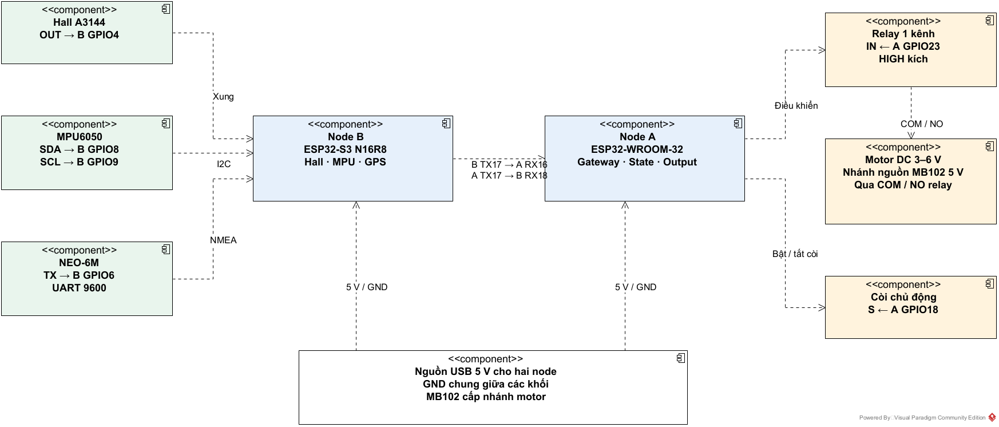

## 8.1. Thành phần và đấu nối

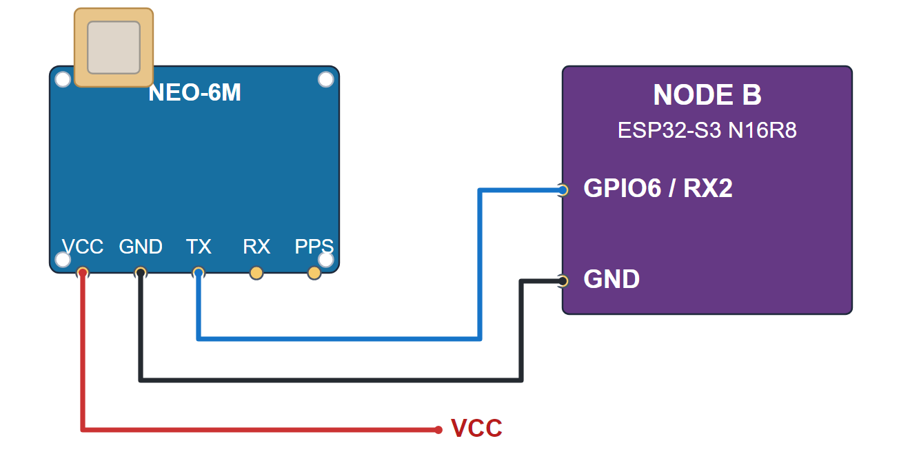

Node A là gateway ESP32; Node B dùng ESP32-S3 N16R8 [11]. Hall tạo xung theo bánh quay; MPU-6050 đo gia tốc; NEO-6M xuất bản tin NMEA qua UART. Relay đóng/ngắt nguồn motor mô phỏng, còn buzzer phát cảnh báo tại chỗ.

**Bảng 5. Nối chân và nguồn của mô hình.**

| Thành phần | Kết nối | Điều kiện |
|---|---|---|
| UART A → B | A TX17 → B RX18 | 115200 baud, 8N1 |
| UART B → A | B TX17 → A RX16 | Nối chung GND |
| MPU-6050 | SDA → B8; SCL → B9 | I2C; VCC3V3 khi breakout hỗ trợ |
| Hall | OUT → B4 | Mức tín hiệu không vượt 3,3 V |
| GPS NEO-6M | TX → B6/RX2; GND chung | 9600 baud; RX/PPS để hở |
| GPS VCC | Nguồn phù hợp breakout | Chỉ dùng 5 V nếu có mạch nguồn hỗ trợ |
| Relay | IN → A23; VCC5V; GND chung | Module nhận logic 3,3 V, chọn HIGH |
| Buzzer/LED | Buzzer → A18; LED onboard A2 | Buzzer tải lớn cần driver |
| Motor | Nguồn → COM; NO → motor(+); motor(−) → GND nguồn | NC để hở, điện áp đúng motor |

NEO-6M là tên bộ thu; điện áp của bộ thu và mạch breakout có thể khác nhau [12][13]. Kết nối đọc vị trí sử dụng ba dây VCC, GND và TX. GPIO7 được cấu hình làm TX2, còn GPS RX/PPS để hở vì hệ thống chỉ nhận dữ liệu từ module.

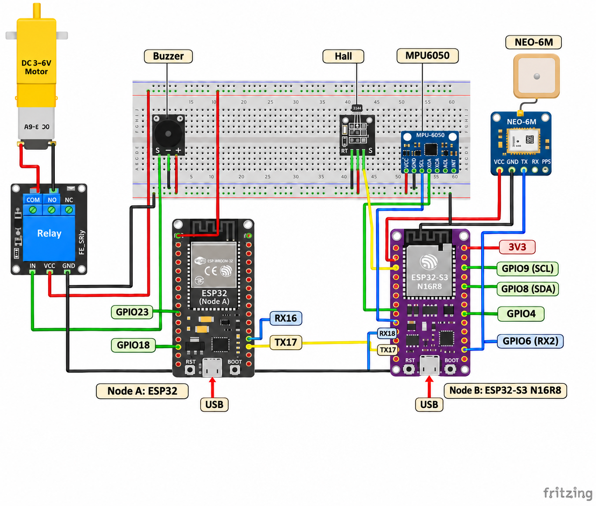

Hình minh họa bố trí linh kiện và các chân giao tiếp của hệ thống.[^ai-image] Dây đỏ biểu thị nguồn, dây đen là GND, dây xanh/vàng là tín hiệu. Kết nối và điều kiện nguồn khi lắp mạch được xác định theo Bảng 5 và sơ đồ chân của board thực tế.

## 8.2. Nguồn và tải

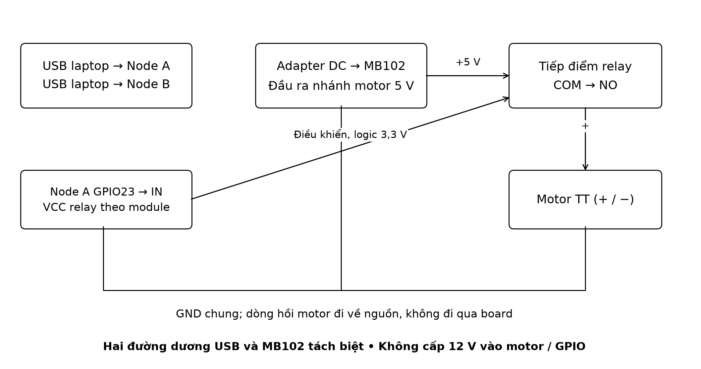

Hai node được cấp qua USB; motor dùng nhánh MB102 riêng theo cấu hình đã vận hành. Đường dương nguồn motor không nối chung với đường USB5V; GND được nối chung để có tham chiếu điều khiển. Dây hồi motor đi về nguồn tải, hạn chế chạy qua đường nguồn logic.

Node A sử dụng `RELAY_ACTIVE_LOW=false` và `RELAY_POWER_ON_AT_BOOT=true`: relay kích HIGH và motor được cấp nguồn sau khởi tạo. Khi ARM được chấp nhận, motor ngắt để chuyển sang bảo vệ; DISARM/UNLOCK cấp lại nguồn theo máy trạng thái. Relay thuộc phần điều khiển của Node A.

Motor TT được cấp điện áp phù hợp định mức, không nhận trực tiếp 12 V từ adapter. Tụ gốm gần motor, tụ hóa trên nhánh nguồn và diode dập xung giúp hạn chế nhiễu. Khả năng cấp dòng và tản nhiệt của MB102 vẫn ảnh hưởng đến điện áp khi motor khởi động. Thiết kế nguồn logic tham khảo hướng dẫn phần cứng của Espressif [14].

## 8.3. Tổ chức tác vụ FreeRTOS và dữ liệu dùng chung

Firmware dùng các tác vụ FreeRTOS để tách công việc có nhịp xử lý và mức ưu tiên khác nhau [4]. Node B có bốn tác vụ; Node A có ba tác vụ. Bảng dưới thể hiện cấu hình truyền vào hàm tạo tác vụ trong mã nguồn.

**Bảng 6. Phân công tác vụ FreeRTOS trong mã nguồn.**

| Node / tác vụ | Core | Ưu tiên | Tham số stack | Công việc |
|---|---|---|---|---|
| B: SensorTask | 1 | 3 | 4096 | Đọc Hall/MPU và đưa mẫu vào hàng đợi |
| B: ProcessingTask | 1 | 2 | 4096 | Cập nhật telemetry, nhận biết rung/nghiêng |
| B: UARTTxRxTask | 0 | 2 | 4096 | Gửi mẫu/sự kiện và nhận heartbeat |
| B: GpsTask | 0 | 1 | 4096 | Đọc UART2, phân tích NMEA |
| A: UARTRxTask | 0 | 3 | 4096 | Nhận cảm biến và trao đổi heartbeat |
| A: ControlTask | 1 | 2 | 6144 | Máy trạng thái, điều kiện lệnh, relay/còi/LED |
| A: MQTTTask | 0 | 2 | 8192 | Wi-Fi, MQTT, bản tin và phản hồi |

SensorTask có ưu tiên cao hơn ProcessingTask để duy trì nhịp lấy mẫu 50 ms. Tác vụ sử dụng `vTaskDelayUntil`, duy trì lịch lấy mẫu theo mốc thức dậy của tác vụ thay vì cộng thêm thời gian xử lý vào mỗi khoảng nghỉ. ProcessingTask chờ `sensorQueue`, nên không quay vòng liên tục khi chưa có mẫu. Việc gán core và ưu tiên giúp tổ chức tải xử lý; đây không phải cam kết mọi phép đo luôn đúng chu kỳ tuyệt đối khi hệ thống chịu tải.

Node B tạo `sensorQueue` chứa 10 mẫu và `eventQueue` chứa 5 sự kiện. Mẫu cảm biến được sao chép vào hàng đợi; khi hàng đợi mẫu đầy, bộ đếm `droppedSamples` tăng để nhận biết tình trạng xử lý không theo kịp. Telemetry gần nhất được bảo vệ bằng `telemMutex`, còn tọa độ GPS dùng `gpsMutex`. Mỗi tác vụ giữ mutex trong thời gian sao chép dữ liệu rồi trả lại, thay vì giữ khóa suốt quá trình gửi UART.

Tại Node A, `controlQueue` chứa 5 lệnh, `alertMqttQueue` chứa 10 sự kiện và `resultQueue` chứa 8 kết quả. Các tác vụ giao tiếp không điều khiển relay trực tiếp; chúng chuyển yêu cầu sang ControlTask. Nhờ đó, thay đổi trạng thái và đầu ra có cùng điểm xử lý. MQTTTask sở hữu kết nối MQTT, còn ControlTask vẫn chạy trên core riêng khi tác vụ mạng chờ nối lại Wi-Fi.

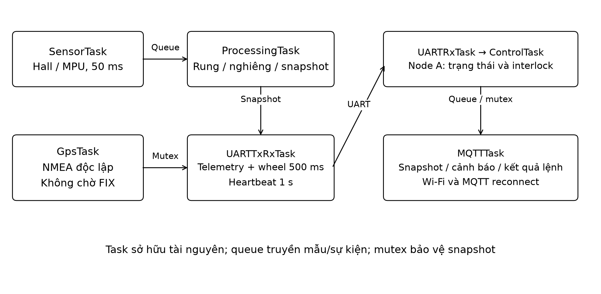

## 8.4. Thu nhận xung Hall và xác định tốc độ hợp lệ

Hall nối vào GPIO4 của Node B và kích ngắt ở cạnh xuống. Hàm ngắt chỉ cập nhật bộ đếm, thời điểm xung và chu kỳ giữa hai xung; không gửi bản tin hoặc thực hiện phép tính dài. Các biến được đọc/ghi trong vùng bảo vệ tới hạn `hallMux`, tránh lấy phải bộ dữ liệu gồm bộ đếm mới nhưng thời gian xung cũ. Mã sử dụng cả `micros()` để đo chu kỳ và `millis()` để xác định thời gian bánh không có xung.

Khoảng cách tối thiểu giữa hai xung thông thường là 10.000 µs, giúp loại bớt nhiễu hoặc nhiều cạnh quá sát nhau. Khi bánh đã dừng ít nhất 4 s, xung mới được xem là bắt đầu một giai đoạn quay mới. Chu kỳ được đặt lại để hai xung thuộc hai lần quay cách xa nhau không tạo thành một tốc độ giả.

Với đường kính 0,065 m, chu vi bánh là khoảng 0,20420352 m. Một nam châm tương ứng một xung mỗi vòng. Tốc độ tính theo công thức `v = C × 3.600.000 / (P × T)`, trong đó C tính bằng mét, P là số xung mỗi vòng và T tính bằng microsecond. Hàm ước lượng dùng giá trị lớn hơn giữa chu kỳ đã đo và thời gian từ xung gần nhất. Vì vậy, khi bánh chậm lại hoặc không xuất hiện xung tiếp theo, tốc độ ước lượng giảm theo khoảng chờ.

Một xung đầu tiên chứng minh có chuyển động nhưng chưa xác định được chu kỳ quay. Firmware biểu diễn tình huống đó bằng `speed_valid=false`, không coi tốc độ 0 tạm thời là bằng chứng xe đã đứng yên. Khi thời gian không có xung đạt 4 s, tốc độ được xác nhận bằng 0. Giá trị tính vượt 120 km/h được đánh dấu không hợp lệ. Cách xử lý này đặc biệt quan trọng với lệnh khóa: giá trị số và tính hợp lệ của nó phải được kiểm cùng nhau.

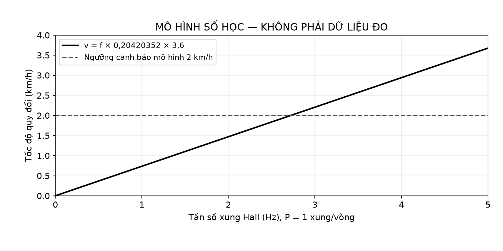

## 8.5. Đọc gia tốc và nhận biết rung, nghiêng

MPU-6050 được đọc qua I2C ở 100 kHz, timeout bus 25 ms. Khởi tạo thử hai địa chỉ 0x68 và 0x69, kiểm thanh ghi nhận dạng `WHO_AM_I`, đánh thức cảm biến rồi chọn dải gia tốc ±4 g. Mỗi lần đọc lấy sáu byte từ thanh ghi 0x3B, ghép thành ba số nguyên 16 bit có dấu. Hệ số `9,80665/8192` chuyển số đọc sang gia tốc m/s². Đường thu nhận sử dụng ba trục gia tốc; dữ liệu con quay hồi chuyển không được đưa vào thuật toán này.

Nếu đọc I2C thất bại, mẫu mang cờ `imu_valid=false` và các giá trị gia tốc ban đầu là NaN. SensorTask thử khởi tạo lại MPU với khoảng cách 3 s. ProcessingTask xóa bộ đếm rung và thời điểm bắt đầu nghiêng khi gặp mẫu MPU không hợp lệ. Dữ liệu lỗi vì thế không được nối tiếp với các mẫu tốt trước đó để đủ điều kiện cảnh báo.

Rung được phát hiện từ độ lệch `abs(norm(a)−9,80665)`. Điều kiện là Node B còn nhận heartbeat Node A, trạng thái nhận về là ARMED và ba mẫu liên tiếp vượt 3,5 m/s². Sau cảnh báo, khoảng cách tối thiểu giữa các lần kích hoạt theo nhánh rung là 4 s. Với nhịp lấy mẫu 50 ms, yêu cầu nhiều mẫu liên tiếp hạn chế phản ứng với một giá trị vượt ngưỡng đơn lẻ.

Góc nghiêng tính bằng `atan2(sqrt(ax²+ay²), az)`. Góc trên 50° được theo dõi liên tục. Sự kiện dấu hiệu ngã xuất hiện khi góc vượt ngưỡng ít nhất 500 ms và mẫu tốc độ tại thời điểm quyết định hợp lệ, không quá 2 km/h; hoặc khi nghiêng trên ngưỡng ít nhất 2 s. Nhánh nghiêng kéo dài không đòi hỏi tốc độ hợp lệ. Khoảng cách kích hoạt của nhánh ngã là 5 s. Hai loại sự kiện dùng chung biến thời điểm cảnh báo gần nhất, nên chúng có thể ảnh hưởng khoảng chờ của nhau. Đây là quy tắc nhận biết dấu hiệu trên mô hình, không phải phép xác nhận tai nạn bằng AI.

## 8.6. Đọc GPS độc lập và quản lý tuổi vị trí

NEO-6M gửi dữ liệu vào GPIO6/RX2 của Node B ở 9600 baud. GpsTask sở hữu đối tượng TinyGPSPlus và UART GPS; mỗi vòng đọc tối đa 512 ký tự rồi nhường CPU 10 ms. Khi thư viện báo tọa độ mới, hợp lệ, chương trình kiểm giá trị hữu hạn và miền vĩ độ/kinh độ trước khi cập nhật `GpsSnapshot` [8]. Snapshot gồm vĩ độ, kinh độ, thời điểm fix gần nhất và cờ đã từng có fix.

UARTTxRxTask ghép tọa độ với telemetry, tính `gps_age_ms` từ thời điểm fix và đánh dấu hợp lệ khi tuổi không vượt 5 s. Chưa từng có fix được biểu diễn bằng cờ false và tuổi `UINT32_MAX`. Khi đã có vị trí nhưng không nhận cập nhật đủ mới, log chuyển sang STALE. Do cấu trúc vẫn giữ tọa độ gần nhất, phía nhận có thể giải thích vị trí cũ mà không tự tạo tọa độ thay thế.

Node A cộng thêm thời gian từ lúc nhận telemetry vào tuổi GPS trước khi phát MQTT, đồng thời kiểm độ mới của cảm biến, miền tọa độ và cờ hợp lệ. Như vậy, việc mẫu đang nằm trong bộ nhớ gateway không làm tuổi vị trí dừng tăng. Log số ký tự và lỗi checksum dùng để kiểm tra đường nhận dữ liệu; việc nhận NMEA liên tục không tự chứng minh GPS có định vị.

## 8.7. Relay và đầu ra do Node A quản lý

Relay nối GPIO23, buzzer nối GPIO18 và LED onboard dùng GPIO2 của Node A. Hàm `set_motor` chuyển yêu cầu cấp/ngắt nguồn sang mức logic theo cấu hình. Node A dùng `RELAY_ACTIVE_LOW=false`, tương ứng module kích HIGH; `RELAY_POWER_ON_AT_BOOT=true` cấp motor sau khởi tạo. Mức đầu ra relay được đặt trước khi chuyển chân sang OUTPUT để khởi tạo theo giá trị cấu hình.

ARM được chấp nhận sẽ ngắt motor để canh giữ; DISARM và UNLOCK đưa hệ thống về PARKED và cấp nguồn motor; LOCK chuyển sang THEFT_LOCK và ngắt nguồn. Còi, LED có nhịp báo riêng cho các trạng thái. Hai hằng relay trong config Node B khác Node A nhưng không điều khiển đầu ra này: mã Node B không sử dụng chúng để đóng/ngắt relay. Vì vậy, mô tả logic relay phải dựa vào cấu hình và chương trình Node A.

# 9. THIẾT KẾ GIAO THỨC VÀ LUỒNG DỮ LIỆU

## 9.1. Khung UART và hợp đồng nhị phân

Liên kết giữa hai node dùng UART 115200 baud, 8N1. Node A TX17 nối Node B RX18; Node B TX17 nối Node A RX16; GND là tham chiếu chung. Bản tin gồm byte bắt đầu 0xAA, loại, độ dài, payload và checksum XOR. Độ dài payload tối đa 128 byte; checksum áp dụng lên loại, độ dài và toàn bộ payload. Các cấu trúc được đóng gói bằng `#pragma pack(1)`, với kiểm tra kích thước tại thời điểm biên dịch [2].

**Bảng 7. Cấu trúc payload trong giao thức UART.**

| Cấu trúc | Nội dung chính | Kích thước |
|---|---|---|
| TelemetryData | Tốc độ, gia tốc, thời gian, tọa độ, tuổi GPS, thời gian bánh dừng, cờ hợp lệ | 39 B |
| WheelSampleData | version, boot_id, pulse_count, timestamp | 13 B |
| AccelEventData | Loại sự kiện, giá trị, thời gian | 9 B |
| HeartbeatData | Trạng thái, sequence, uptime | 6 B |
| CmdRelayData | Trạng thái relay và sequence | 2 B |
| NackData | Mã lỗi và loại bản tin liên quan | 2 B |

Parser nhận từng byte, lần lượt chờ đầu khung, loại, độ dài, dữ liệu và checksum. Loại ngoài miền hỗ trợ hoặc độ dài vượt giới hạn làm parser quay về chờ đầu khung. Khi khoảng cách byte vượt 50 ms trong một frame chưa hoàn tất, parser bỏ frame đang nhận. Chỉ sau khi checksum đúng, payload mới được chuyển sang tác vụ xử lý; nơi nhận tiếp tục kiểm kích thước đúng với loại bản tin. NACK có cấu trúc riêng, nhưng parser không tự phát NACK cho mọi lỗi checksum hoặc timeout; nhiều lỗi khung được xử lý bằng bỏ frame và đồng bộ lại.

Node B gửi telemetry và bộ đếm bánh mỗi 500 ms; mỗi vòng giao tiếp ưu tiên lấy sự kiện từ hàng đợi trước khi gửi dữ liệu định kỳ. Hai phía gửi heartbeat 1 s và coi liên kết mất sau hơn 3 s không nhận được. Mẫu cảm biến chỉ đủ mới trong 1.500 ms. Tại Node B, cờ tốc độ và MPU được kết hợp với tuổi mẫu trước khi truyền; tại Node A, thời gian nhận và heartbeat tiếp tục được kiểm trước khi sử dụng dữ liệu.

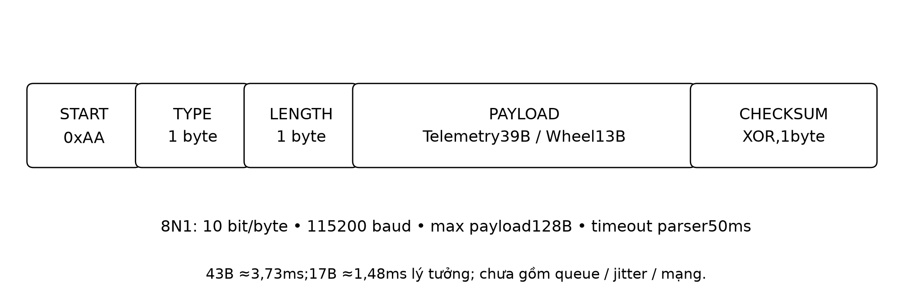

Telemetry 39 B tạo frame 43 B. Với 8N1 ở 115200 baud, thời gian truyền lý tưởng khoảng 3,73 ms [17]. Phép tính chưa gồm lấy mẫu, hàng đợi, mạng và render ứng dụng.

## 9.2. Wi-Fi và MQTT

Wi-Fi đưa Node A vào mạng IP. MQTT chuyển bản tin theo topic qua broker [3]. Web và mobile trao đổi với backend qua REST/STOMP để kiểm quyền trước khi đọc hoặc điều khiển. MQTT không thay vai trò truy cập mạng của Wi-Fi.

**Bảng 8. Topic và trách nhiệm truyền nhận.**

| Topic dưới `guardian/{device_uuid}/` | Chiều | Ý nghĩa |
|---|---|---|
| telemetry | A → server | Phép đo, trạng thái, tính hợp lệ |
| alert | A → server | Sự kiện cần cảnh báo |
| status; heartbeat | A → server | Sự hiện diện và thông tin vận hành |
| wheel_session | A → server | Snapshot thống kê phiên bánh |
| cmd/{type} | Server → A, A đăng ký cmd/# | Ví dụ cmd/lock_engine; JSON type=LOCK_ENGINE, có cmd_id |
| cmd/ack | A → server | Kết quả và lý do của lệnh |

## 9.3. MQTT, bản tin JSON và điều kiện thực thi lệnh

MQTTTask chuyển dữ liệu nhị phân thành JSON theo namespace `guardian/{device_uuid}/`. Telemetry và phiên bánh được phát khoảng 1 s, heartbeat mạng khoảng 15 s. Cảnh báo sử dụng topic alert, còn lệnh dùng `cmd/{type}` và kết quả dùng `cmd/ack`. Các sự kiện có loại và đơn vị riêng: rung dùng m/s², nghiêng dùng độ, bánh quay dùng số xung, quá tốc độ dùng km/h. Trường `ts` của thiết bị là uptime tính bằng giây, không phải thời gian lịch.

Trước khi phát telemetry, Node A kiểm liên kết cảm biến, tuổi mẫu, giá trị hữu hạn và cờ hợp lệ. Những trường không có dữ liệu hợp lệ được bỏ khỏi JSON; ví dụ, không phát tốc độ khi `speed_valid=false` và không tự điền điện áp pin khi chưa có phép đo ADC. Backend có thể lưu null và giao diện biểu diễn thiếu dữ liệu thay vì đọc nhầm một giá trị mặc định.

Callback nhận lệnh kiểm payload không quá 384 byte, phân tích JSON và kiểm `cmd_id` dài dưới 40 ký tự. Mã lệnh chỉ chấp nhận chữ/số, dấu gạch ngang và gạch dưới; loại JSON phải khớp hậu tố topic. Callback bỏ qua topic kết thúc bằng `/ack`, tránh phản hồi vào chính ACK. Lệnh hợp lệ được đưa vào controlQueue; hàng đợi đầy trả QUEUE_FULL, còn loại không hỗ trợ trả UNSUPPORTED_COMMAND.

ARM, LOCK và REBOOT đi qua `lock_block_reason`: đã có telemetry, heartbeat còn mới, dữ liệu nhận không quá 1.500 ms, tốc độ hữu hạn/hợp lệ và không âm, tốc độ không quá 0,5 km/h, bánh không có xung ít nhất 4 s. ARM và reset phiên còn yêu cầu dữ liệu bộ đếm bánh mới. Các điều kiện giải thích vì sao gửi yêu cầu từ ứng dụng không đồng nghĩa thiết bị chắc chắn thực hiện.

ControlTask lưu vòng tám kết quả lệnh từ xa theo cmd_id. Khi nhận lại mã còn trong cache, tác vụ trả kết quả đã có mà không lặp tác động. Kết quả đi qua resultQueue; MQTTTask giữ ACK đang chờ nếu publish chưa thành công. Lệnh REBOOT chỉ khởi động lại sau khi publish ACK thành công và chờ 200 ms. Cache ở RAM có phạm vi tám lệnh và mất sau khởi động, vì vậy không phải cơ chế chống trùng bền vững.

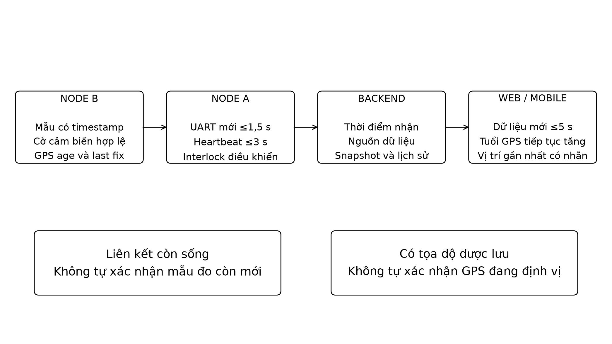

## 9.4. Luồng cảm biến và cảnh báo

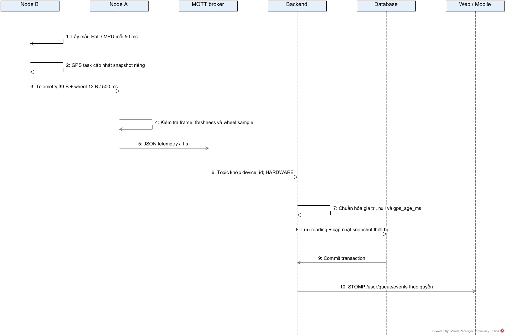

Node B chuyển mẫu và sự kiện qua UART; Node A kiểm dữ liệu rồi phát MQTT. Backend xác định nguồn, kiểm vòng đời, cập nhật snapshot/lịch sử trong giao dịch. Sau commit, sự kiện được gửi cho tài khoản có quyền. Cảnh báo có loại, mức độ và thời điểm; còi phát tại chỗ, ứng dụng cung cấp lịch sử và thao tác xác nhận.

## 9.5. Luồng lệnh và trạng thái bảo vệ

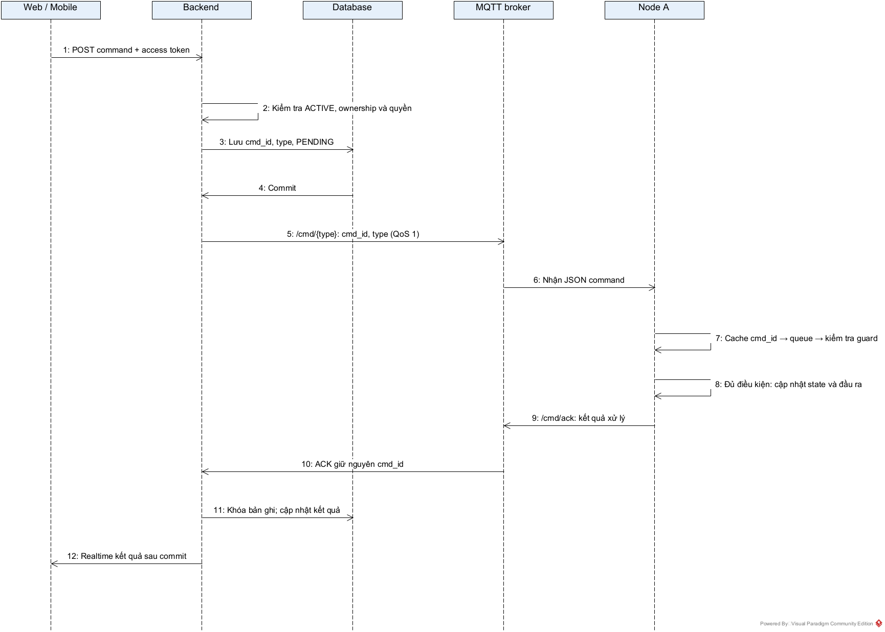

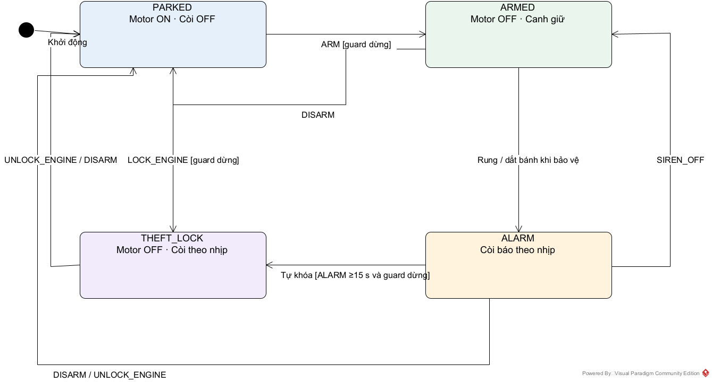

**Bảng 9. Trạng thái và điều kiện điều khiển.**

| Trạng thái / thao tác | Ý nghĩa và điều kiện |
|---|---|
| PARKED | Chưa bật bảo vệ; tốc độ khác 0 không tự đổi thành trạng thái khác |
| ARMED | Canh giữ rung và bánh quay; ARM cần dữ liệu mới, tốc độ ≤0,5 km/h và bánh không có xung ít nhất 4 s |
| ALARM | Đã phát sinh sự kiện báo động; đầu ra theo logic trạng thái |
| THEFT_LOCK | Đang ở chế độ khóa; thực thi khóa phải qua interlock |
| LOCK / REBOOT | Kiểm điều kiện vận hành tại firmware; từ chối nếu dữ liệu cũ hoặc bánh chưa dừng |
| DISARM / UNLOCK | Thoát chế độ tương ứng và cập nhật đầu ra theo firmware |

ACK xác nhận xử lý tại firmware. Hệ thống không đo trực tiếp tiếp điểm relay; hoạt động chấp hành được đối chiếu bằng quan sát motor.

## 9.6. Phục hồi kết nối và bộ đệm cảnh báo

MQTTTask thử lại Wi-Fi sau khoảng chờ 3 s khi có cấu hình hợp lệ; trường hợp chưa cấu hình chờ 5 s. Khi Wi-Fi đã kết nối, gateway thử kết nối broker và chờ 4 s nếu thất bại. Kết nối khai báo Last Will trên topic status, nội dung offline có retain; sau khi kết nối, gateway phát online có retain và đăng ký lại topic lệnh. Last Will do broker phát khi xác định kết nối bị mất, không phải cảnh báo tức thì ngay lúc rút nguồn.

Cảnh báo đi qua bộ đệm vòng RAM tối đa 30 mục, mỗi mục có topic và payload giới hạn. Khi đầy, mục cũ nhất bị ghi đè. Hàm xả xử lý một mục mỗi lần gọi và chỉ bỏ mục sau khi publish thành công. Telemetry định kỳ không đi qua bộ đệm này; ACK sử dụng biến chờ riêng. Tham số QoS lưu trong struct không biến lệnh publish của PubSubClient thành QoS1: đường publish thực tế vẫn dùng khả năng của thư viện. Bộ đệm hỗ trợ gián đoạn ngắn, không bảo đảm giữ toàn bộ lịch sử khi mất điện, đầy queue hoặc mất mạng kéo dài.

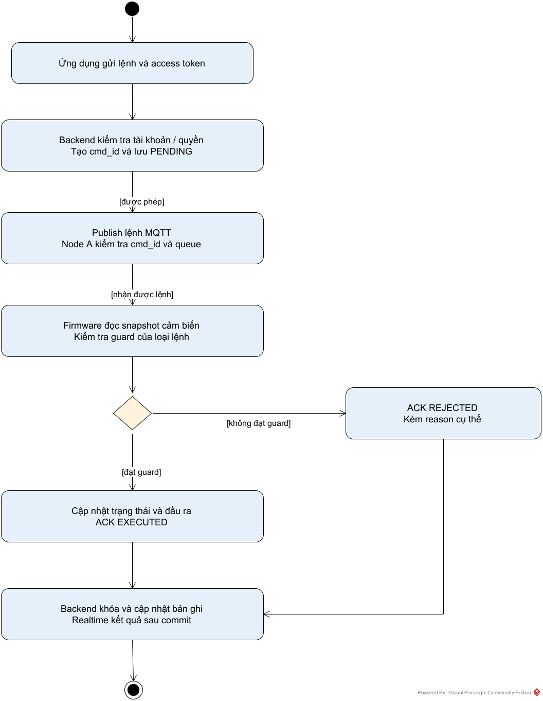

<!-- PAGE -->

# 10. THIẾT KẾ CƠ SỞ DỮ LIỆU, API VÀ BACKEND

## 10.1. Cơ sở dữ liệu

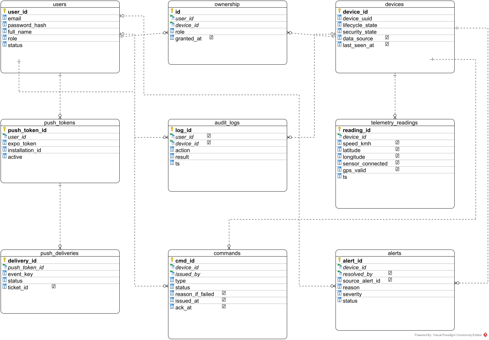

**Bảng 10. Các bảng dữ liệu chính.**

| Bảng | Dữ liệu và ràng buộc chính |
|---|---|
| users | Tài khoản, mật khẩu băm, vai trò/trạng thái; email duy nhất |
| devices | UUID, metadata, vòng đời, trạng thái bảo vệ và snapshot cuối |
| ownership | Quan hệ người–xe và quyền; mỗi cặp có ràng buộc duy nhất |
| telemetry_readings | Lịch sử phép đo, nguồn, thời gian và validity |
| commands | cmd_id, người gửi, loại lệnh, trạng thái và ACK |
| alerts | Loại sự kiện, mức độ, trạng thái và người xử lý |
| audit_logs | Chủ thể, thao tác, kết quả và thời điểm |
| push_tokens | Installation, nền tảng, token và trạng thái kích hoạt |
| push_deliveries | Sự kiện gửi, ticket/kết quả và chống trùng theo token |

## 10.2. Backend và API

Backend dùng Spring Boot, Java 17, JPA, Paho và JWT; các khối giao tiếp và xử lý được thể hiện dưới đây.

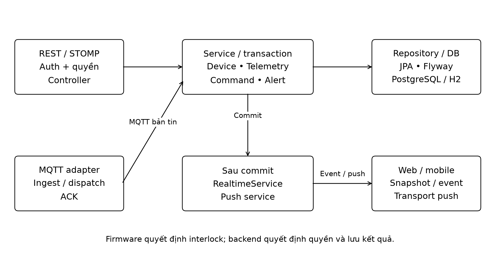

**Bảng 11. API chính, tiền tố `/api`.**

| API | Mục đích / điều kiện |
|---|---|
| POST /auth/register, /auth/login, /auth/refresh | Tài khoản và phiên đăng nhập |
| GET /devices; POST /devices/onboard | Danh sách trong quyền và kích hoạt thiết bị |
| PATCH /devices/{id}/config | Thông tin thiết bị; thay đổi ngưỡng từ xa áp dụng cho nguồn SIMULATED |
| GET /devices/{id}/telemetry | Lịch sử theo from/to, page/size, kiểm quyền đọc |
| GET /devices/{id}/telemetry/export | Xuất CSV trong khoảng dữ liệu được phép |
| POST /devices/{id}/command | OWNER/ADMIN; LOCK cần xác nhận mật khẩu |
| GET /devices/{id}/commands | Lịch sử lệnh và kết quả |
| GET /devices/{id}/wheel-session | Snapshot phiên; reset qua command |
| POST /alerts/{id}/acknowledge, /alerts/{id}/resolve | Xác nhận và xử lý cảnh báo |
| POST /devices/{id}/revoke, /devices/{id}/decommission | Thay đổi vòng đời theo quyền |

STOMP tại `/ws` cung cấp cập nhật theo kênh cá nhân. Hợp đồng sự kiện được mô tả ở phần REST/realtime; xác thực và quyền đăng ký kênh nằm ở mục 12.

Với các luồng ghi database, sự kiện realtime và thông báo đẩy được phát sau khi giao dịch hoàn tất [18]. Nhờ đó, ứng dụng có thể tra cứu bản ghi tương ứng ngay khi nhận sự kiện. Khi mất WebSocket, ứng dụng sử dụng REST để lấy lại dữ liệu.

## 10.3. Phân chia trách nhiệm trong backend

Backend được tổ chức thành một ứng dụng Spring Boot với các nhóm controller, service, repository, entity và DTO. Controller ánh xạ yêu cầu HTTP, lấy người dùng đã xác thực và chuyển dữ liệu đầu vào tới service. Service quyết định thao tác có được phép thực hiện hay không, xử lý giao dịch và tạo sự kiện. Repository truy cập cơ sở dữ liệu qua JPA; entity mô tả dữ liệu lưu trữ, còn DTO xác định phần dữ liệu trao đổi với ứng dụng.

Hai đường vào của backend có trách nhiệm khác nhau. REST nhận thao tác của người dùng như xem xe, chia sẻ quyền, xử lý cảnh báo và gửi lệnh. MQTT nhận bản tin của thiết bị như cảm biến, trạng thái kết nối, phiên bánh và ACK. Cả hai cùng sử dụng các service quản lý thiết bị, dữ liệu và quyền, nhờ đó thông tin trên web và mobile phản ánh cùng một trạng thái nghiệp vụ.

DTO giúp kiểm soát thông tin công bố: dữ liệu thiết bị gửi qua realtime được loại mã kích hoạt và gắn quyền của từng người nhận. Sự kiện DEVICE vì vậy phản ánh cả trạng thái xe và vai trò của người đang xem.

## 10.4. Quan hệ dữ liệu và tính nhất quán

Mô hình quan hệ gồm chín bảng. `users` lưu tài khoản; `devices` lưu thiết bị và trạng thái gần nhất. Bảng `ownership` nối người dùng với xe, cho phép một tài khoản theo dõi nhiều xe và một xe được chia sẻ với nhiều người. Ràng buộc duy nhất trên cặp người–xe ngăn cùng một quan hệ quyền bị tạo lặp. Vai trò trong quan hệ này được dùng khi kiểm thao tác trên xe, độc lập với vai trò quản trị ở cấp hệ thống.

Ba bảng `telemetry_readings`, `alerts` và `commands` lưu ba loại lịch sử. Phép đo là chuỗi mẫu theo thời gian; cảnh báo là một sự kiện có vòng đời OPEN, ACKNOWLEDGED, RESOLVED; lệnh là một yêu cầu có người gửi và kết quả thực thi. Tách chúng thành các bảng riêng giúp việc xác nhận đã xem cảnh báo không làm thay đổi số đo, và kết quả lệnh không bị suy ra từ trạng thái hiển thị cuối cùng của xe.

`audit_logs` lưu chủ thể, thiết bị liên quan, hành động, kết quả, địa chỉ nguồn và thời gian. Khóa ngoại cho người dùng hoặc thiết bị có thể được đặt null khi đối tượng bị xóa, nhờ đó nhật ký không nhất thiết biến mất cùng đối tượng. Ngược lại, các lịch sử gắn trực tiếp với thiết bị sử dụng quan hệ khóa ngoại để giữ toàn vẹn tham chiếu. Các chỉ mục theo thiết bị–thời gian, thiết bị–trạng thái và người dùng–thời gian hỗ trợ truy vấn lịch sử theo đúng cách ứng dụng sử dụng.

Hai bảng `push_tokens` và `push_deliveries` phục vụ thông báo di động. Token được gắn với tài khoản và một lần cài đặt ứng dụng. Cặp người dùng–installation và bản thân Expo token có ràng buộc duy nhất. Mỗi lần gửi được xác định bằng cặp event key–token, giúp cùng sự kiện không bị tạo nhiều lượt gửi cho một đích chỉ vì luồng xử lý được gọi lại.

Flyway quản lý cấu trúc qua các migration, còn Hibernate kiểm tra schema bằng chế độ `validate`. Migration bổ sung thông tin realtime đã loại các giá trị mặc định dễ gây nhầm như vị trí, tốc độ và điện áp mẫu. Dữ liệu lịch sử được đánh dấu LEGACY thay vì tự chuyển thành số đo thiết bị thật. Thiết kế này giữ rõ khác biệt giữa dữ liệu đã thu nhận, dữ liệu mô phỏng và dữ liệu có nguồn gốc từ cấu trúc cũ.

## 10.5. Tiếp nhận và chuẩn hóa dữ liệu IoT

MQTT adapter đăng ký các topic dưới `guardian/+/...`, lấy UUID từ topic rồi kiểm tra trường `device_id` trong JSON nếu trường này được gửi kèm. Bản tin có hai định danh không khớp bị bỏ qua. Lớp adapter chuyển tên trường dạng snake_case của firmware sang DTO Java rồi gọi service; thông tin nguồn ở đường MQTT được xác định là HARDWARE.

`TelemetryService` tìm thiết bị dưới khóa ghi và từ chối dữ liệu của thiết bị không tồn tại, bị thu hồi hoặc đã ngừng sử dụng. Nguồn bản tin phải trùng nguồn của thiết bị. Một thiết bị mô phỏng không được tự trở thành thiết bị thật chỉ bằng cách gửi JSON có cùng UUID. Tương tự, endpoint REST nhận telemetry chỉ dành cho thiết bị SIMULATED và yêu cầu người gửi có quyền quản lý.

Tính hợp lệ được xét riêng cho từng nhóm phép đo. Tốc độ chỉ hợp lệ khi liên kết cảm biến còn hoạt động, cờ `speed_valid` đúng và giá trị là số hữu hạn không âm. MPU cần đủ ba trục hữu hạn cùng cờ `imu_valid`. GPS cần tọa độ nằm trong miền vĩ độ ±90°, kinh độ ±180°, cờ hợp lệ và tuổi mẫu từ 0 đến 5.000 ms. Tốc độ, gia tốc hoặc tọa độ không đạt điều kiện được giữ null ở mẫu lịch sử; tuổi GPS vẫn có thể được lưu để giải thích trạng thái vị trí.

Đối với vị trí, bản tin mất định vị không xóa tọa độ hợp lệ gần nhất của thiết bị. Backend chỉ cập nhật `lastLatitude`, `lastLongitude` và `lastLocationReceivedAt` khi có GPS hợp lệ; đồng thời vẫn cập nhật `gpsValid` để ứng dụng biết tọa độ lưu lại không còn là vị trí mới. Nhờ đó bản đồ có thể trình bày vị trí gần nhất mà không giả định xe đang ở đó.

Thời gian được quản lý ở hai miền. `deviceUptimeS` giữ thời gian hoạt động do firmware gửi; `receivedAt` và `ts` của mẫu lưu do server tạo. Uptime không được chuyển trực tiếp thành thời gian lịch. Sau khi thiết bị khởi động lại, uptime có thể nhỏ hơn; mốc nhận vẫn được xác định theo đồng hồ server, độc lập với uptime. Các màn hình lịch sử dựa vào mốc nhận và giữ uptime để hỗ trợ đối chiếu thiết bị.

## 10.6. Phân biệt dữ liệu gần nhất và lịch sử

Mỗi bản tin cảm biến hợp lệ về nguồn và trạng thái tạo một hàng trong `telemetry_readings`, đồng thời cập nhật trạng thái gần nhất trong `devices`. Dashboard lấy thông tin thiết bị để hiển thị nhanh, còn biểu đồ và xuất dữ liệu truy vấn các mẫu theo khoảng thời gian. Cách lưu này tránh phải quét toàn bộ lịch sử chỉ để hiển thị danh sách xe.

API lịch sử nhận `from`, `to` theo epoch giây, cùng `page` và `size`. Khi không truyền khoảng, service sử dụng khoảng 24 giờ kết thúc tại thời điểm truy vấn. Kích thước trang từ 1 đến 5.000; `from` lớn hơn `to` hoặc số trang âm bị từ chối. Kết quả mỗi trang được truy vấn từ mới đến cũ rồi đảo lại để phục vụ biểu đồ theo chiều thời gian. CSV sử dụng cùng quyền và khoảng truy vấn, với tối đa 5.000 mẫu trong một lần xuất theo cách triển khai này.

Thống kê phiên bánh có cách lưu khác: `WheelSessionService` giữ snapshot mới nhất trong bộ nhớ, không ghi một bảng lịch sử phiên. Service kiểm kiểu dữ liệu, số hữu hạn, chu vi và số xung/vòng, đồng thời đối chiếu quãng đường với công thức từ tổng xung. Với cùng nguồn phiên, sequence được so theo vòng 32 bit; bản lặp hoặc cũ bị bỏ. Khi vẫn cùng session, bộ đếm xung và quãng đường không được giảm. Snapshot quá 5 s hoặc thiết bị không còn ACTIVE/không có liên kết cảm biến được trả về với `fresh=false`.

## 10.7. Giao dịch, sự kiện và phản hồi điều khiển

Khi nhận yêu cầu điều khiển, backend kiểm quyền Owner/Admin, trạng thái vòng đời và loại lệnh hỗ trợ. Lệnh LOCK_ENGINE yêu cầu người dùng xác nhận mật khẩu. Backend tạo `cmd_id` dạng UUID, lưu command PENDING, ghi audit và chuẩn bị sự kiện COMMAND. Việc phát lệnh sang MQTT được đăng ký sau khi giao dịch lưu command đã hoàn tất. Nhờ đó ACK quay về có một bản ghi tương ứng để đối chiếu.

Lớp gửi lệnh mở giao dịch riêng, đọc lại command và chỉ xử lý nếu trạng thái vẫn PENDING. Thiết bị SIMULATED đi qua bộ mô phỏng; thiết bị thật đi qua MQTT. Topic lệnh dùng tên loại viết thường, chẳng hạn `guardian/{uuid}/cmd/lock_engine`, trong khi JSON mang `type=LOCK_ENGINE`. Lệnh publish có QoS1 và không retained để một thiết bị nối lại không tự nhận lệnh cũ chỉ vì broker giữ bản tin. Nếu broker không sẵn sàng, command chuyển REJECTED với lý do `MQTT_UNAVAILABLE`.

ACK phải khớp cả `cmd_id` lẫn thiết bị và chỉ chấp nhận kết quả EXECUTED hoặc REJECTED. Service khóa hàng command trước khi cập nhật. Nếu command đang PENDING, kết quả và thời điểm ACK được ghi lại; ACK lặp sau trạng thái kết thúc bị bỏ. Bộ kiểm timeout chạy mỗi 1 s, chuyển yêu cầu quá thời gian chờ mặc định 10 s thành TIMEOUT với lý do `ACK_TIMEOUT`.

ACK đến sau timeout không xóa sự kiện quá hạn: trạng thái TIMEOUT được giữ và các trường `lateAckResult`, `lateAckReason`, `lateAckAt` ghi phản hồi muộn đầu tiên. Cách xử lý này giúp lịch sử diễn đạt đúng cả việc người dùng đã phải chờ quá lâu và việc thiết bị trả lời sau đó. Khóa ghi cùng điều kiện trạng thái ngăn luồng timeout và luồng ACK đồng thời kết thúc cùng lệnh theo hai cách khác nhau. Backend không có vòng tự động phát lại command quá hạn; một yêu cầu mới của người dùng tạo một mã lệnh mới.

## 10.8. Hợp đồng REST và realtime

REST thông thường trả cấu trúc `ApiResponse` gồm `success`, `message`, `data` và `timestamp` tính bằng mili giây trên server. DTO sử dụng tên camelCase, ví dụ `gpsValid`, `gpsAgeMs`, `deviceUptimeS`; lớp MQTT chịu chuyển đổi từ tên trường của firmware. Các ví dụ dưới đây minh họa hợp đồng, không phải log đo.

```json
{"type":"LOCK_ENGINE","confirmationPassword":"<mat-khau-xac-nhan>"}
```

Yêu cầu được gửi tới `POST /api/devices/{id}/command`. Phản hồi chứa mã command và PENDING; người dùng theo dõi kết quả qua sự kiện hoặc `GET /api/devices/{id}/commands`, trả tối đa 100 lệnh gần nhất. HTTP thành công chỉ cho biết service đã nhận yêu cầu hợp lệ, không thay ACK của firmware.

```json
{"type":"COMMAND","deviceId":"device-demo","data":{"cmdId":"cmd-demo","type":"LOCK_ENGINE","status":"REJECTED","reasonIfFailed":"SPEED_NOT_ZERO"},"sentAt":"<thoi-diem-server>"}
```

Sự kiện STOMP có cùng envelope `type`, `deviceId`, `data`, `sentAt`. Web và mobile sử dụng loại sự kiện để cập nhật đúng vùng dữ liệu: TELEMETRY cho phép đo, DEVICE cho trạng thái thiết bị, ALERT cho cảnh báo, COMMAND cho yêu cầu điều khiển và WHEEL_SESSION cho phiên bánh. Với luồng ghi database, sự kiện được phân phối sau commit để dữ liệu đọc lại qua REST phù hợp với thông báo. Snapshot phiên bánh lưu trong RAM được phát sau khi cập nhật bộ nhớ, không có giao dịch database tương ứng.

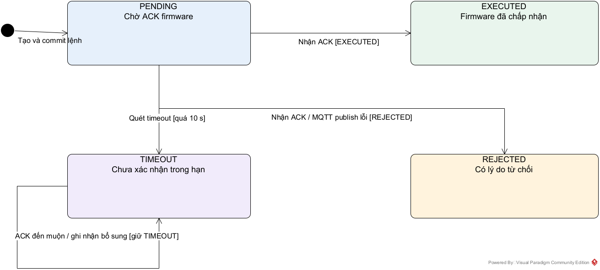

# 11. QUẢN LÝ VÒNG ĐỜI THIẾT BỊ

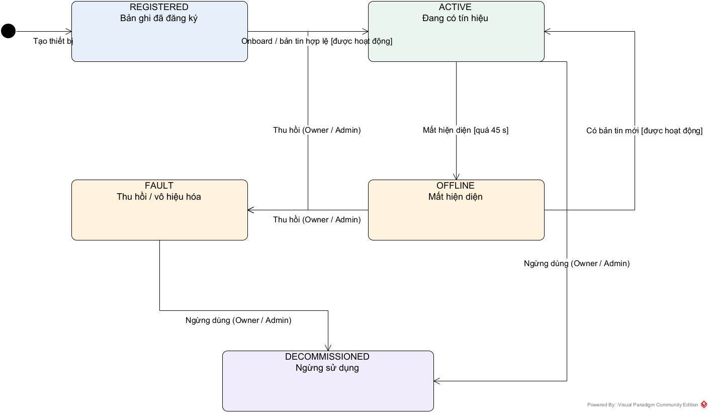

Thiết bị được đăng ký với UUID và thông tin mô tả, sau đó liên kết với người dùng qua quy trình kích hoạt. Backend dựa vào bản tin để xác định thiết bị đang kết nối hay ngoại tuyến. Chủ xe hoặc quản trị viên có thể thu hồi và ngừng sử dụng thiết bị theo quyền được cấp.

## 11.1. Kích hoạt và liên kết thiết bị với chủ xe

Thiết bị có UUID phục vụ giao tiếp và mã kích hoạt dùng để nhận quyền sở hữu. Khi onboarding, service tìm mã, kiểm tra thiết bị chưa có quan hệ ownership và chưa DECOMMISSIONED, sau đó cập nhật thông tin xe. Trong cùng giao dịch, mã kích hoạt được xóa và tạo quan hệ OWNER cho người nhận. Việc xóa mã sau khi dùng hạn chế việc một mã tiếp tục được sử dụng để nhận lại cùng thiết bị.

Quy trình này là liên kết tài khoản với thiết bị trong backend. Nó không tự cài đặt Wi-Fi, tạo chứng thư hay ghi credential xuống ESP32. Những trường mô tả phiên bản firmware hoặc trạng thái provisioning trong mô hình dữ liệu được dùng để quản lý thông tin; chức năng thực tế được xác định bởi luồng service và giao thức đã triển khai.

## 11.2. Sự hiện diện, dữ liệu cũ và thu hồi

Backend nhận trạng thái online/offline và dùng bộ giám sát chạy mỗi 1 s để kiểm lần liên lạc gần nhất. Ngưỡng ngoại tuyến mặc định là 45 s. Nếu thiết bị vẫn liên lạc nhưng hơn 5 s không có telemetry, các cờ cảm biến và tốc độ được vô hiệu hóa mà không nhất thiết chuyển toàn bộ thiết bị sang OFFLINE. Tách hai trường hợp này giúp một gateway còn mạng không che việc liên kết với node cảm biến đã mất.

Tuổi GPS tiếp tục tăng theo thời gian trôi qua từ lúc backend nhận mẫu. Khi tuổi gửi kèm cộng thời gian chờ vượt 5 s, vị trí không còn được đánh dấu là mới. Tọa độ gần nhất vẫn có thể được lưu để tham khảo. Bản tin mới hợp lệ đưa thiết bị OFFLINE hoặc REGISTERED trở lại ACTIVE; bản tin không được khôi phục thiết bị đang FAULT hoặc DECOMMISSIONED.

Thu hồi đặt trạng thái FAULT, còn ngừng sử dụng đặt DECOMMISSIONED. Cả hai xóa trường mật khẩu MQTT lưu trong thiết bị và chặn các service tương ứng. Trong cấu hình broker cho phép kết nối ẩn danh, thay đổi database không tự ngắt quyền publish tại broker. Vì vậy, báo cáo phân biệt thu hồi nghiệp vụ ở backend với thu hồi danh tính kết nối MQTT.

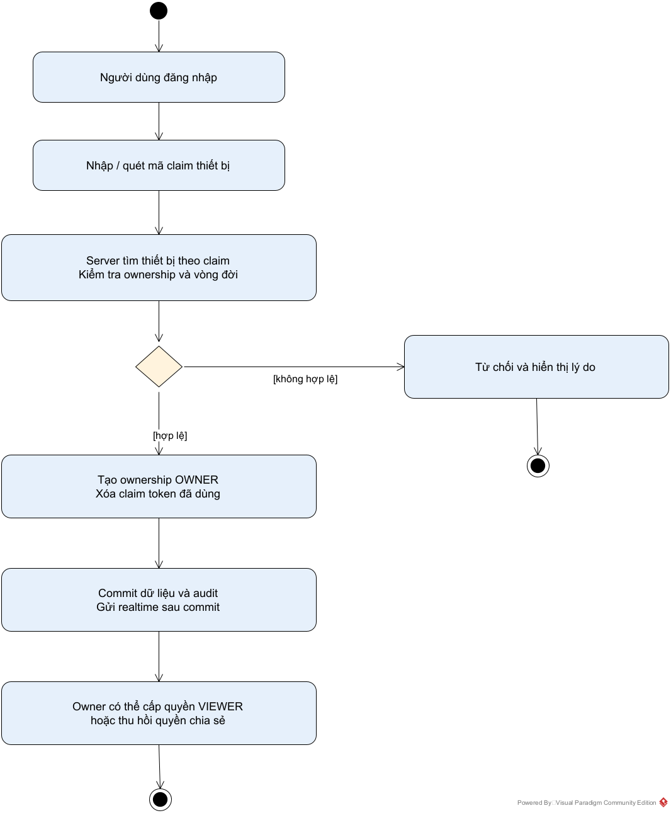

# 12. QUẢN LÝ NGƯỜI DÙNG VÀ PHÂN QUYỀN

Tài khoản có vai trò ở cấp hệ thống, còn quan hệ ownership xác định quyền trên từng xe. Backend kiểm quyền khi xử lý yêu cầu và phân phối sự kiện, kể cả khi client gọi trực tiếp API [19].

**Bảng 12. Ma trận quyền tóm tắt.**

| Chức năng | Viewer | Owner | Admin |
|---|---|---|---|
| Xem xe, cảm biến, vị trí, lịch sử | Xe được chia sẻ | Xe sở hữu | Theo quyền quản trị |
| Gửi lệnh / reset phiên | Không | Có, qua điều kiện | Có, qua điều kiện |
| Đổi cấu hình / chia sẻ quyền | Không | Theo quyền trên xe | Theo phạm vi quản trị |
| Công cụ thử nghiệm | Không | Theo quyền và loại nguồn | Theo quyền và loại nguồn |

## 12.1. Xác thực và quản lý phiên

Đăng ký chuẩn hóa email, kiểm trùng và băm mật khẩu bằng BCrypt. Người dùng không được tự đăng ký ADMIN; vai trò tự đăng ký thuộc OWNER hoặc VIEWER theo yêu cầu hợp lệ. Đăng nhập kiểm mật khẩu và trạng thái ACTIVE rồi trả thông tin người dùng, access token, refresh token và thời hạn access token.

Access token có thời hạn cấu hình 900.000 ms, tương đương 15 phút; refresh token là 604.800.000 ms, tương đương 7 ngày. Hai token có claim `type` khác nhau. Bộ lọc HTTP chỉ chấp nhận ACCESS, kiểm chữ ký/hạn sử dụng, sau đó đọc lại người dùng để kiểm trạng thái và vai trò. Vì vậy refresh token không dùng thay access token khi gọi API thiết bị.

`POST /api/auth/refresh` nhận `refreshToken`, kiểm loại REFRESH và trạng thái tài khoản rồi cấp cặp token mới. Cơ chế này không có bảng phiên hay danh sách thu hồi từng refresh token; việc cấp token mới không tự vô hiệu hóa token cũ còn hạn. Đổi mật khẩu thay giá trị băm trong tài khoản nhưng không được mô tả thành thu hồi toàn bộ JWT đã cấp.

## 12.2. Quyền trên từng xe và kênh realtime

Người dùng thông thường chỉ truy cập xe có quan hệ ownership. Quyền đọc chấp nhận Owner/Viewer; thao tác quản lý và điều khiển yêu cầu Owner. ADMIN được xử lý ở cấp hệ thống. Kiểm này nằm trong service dùng chung, nên việc đoán ID hoặc tự gọi REST không vượt được quyền chỉ vì bỏ qua giao diện.

Kênh WebSocket `/ws` xác thực Bearer ACCESS token trong frame CONNECT. Client chỉ được subscribe `/user/queue/events` và không được dùng SEND để thay đường REST có kiểm quyền. Simple broker trao đổi heartbeat theo nhịp 10 s. Phiên hết hạn token bị chặn khi nhận thao tác tiếp theo hoặc khi server chuyển MESSAGE ra; client cần khôi phục kết nối bằng thông tin xác thực phù hợp.

Khi phát sự kiện, backend đọc danh sách ownership và tài khoản ACTIVE, đồng thời bổ sung quản trị viên còn hoạt động. Mỗi người nhận sự kiện theo kênh cá nhân; token claim kích hoạt không được đưa vào snapshot realtime. Khi chủ xe gỡ một người khỏi xe, quan hệ quyền bị xóa và một sự kiện ACCESS_REMOVED được gửi sau commit để ứng dụng loại dữ liệu đang mở. Những lần phát sau không còn đưa người đó vào danh sách nhận.

## 12.3. Phân quyền xử lý cảnh báo

Cảnh báo có trạng thái OPEN khi được tạo. Người có quyền đọc được xác nhận đã xem, chuyển OPEN thành ACKNOWLEDGED; thao tác này không tuyên bố nguyên nhân sự cố đã được xử lý. Chỉ Owner/Admin được chuyển sang RESOLVED, kèm người xử lý, thời điểm và nội dung hành động. Phân chia này phù hợp với việc một người thân có thể theo dõi xe nhưng không có quyền quyết định điều khiển hoặc kết thúc sự cố thay chủ xe.

# 13. THIẾT KẾ BẢO MẬT VÀ QUYỀN RIÊNG TƯ

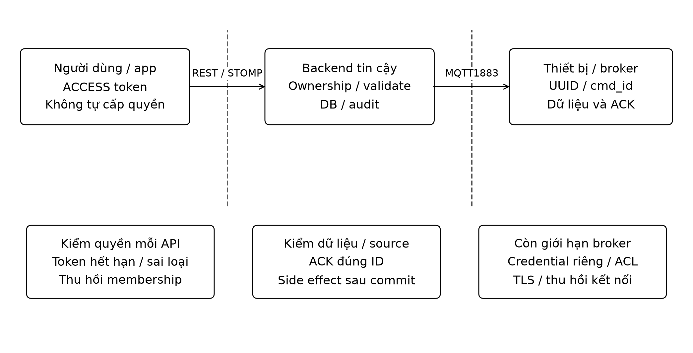

Mật khẩu được băm bằng BCrypt [5]. JWT và refresh token quản lý phiên đăng nhập; backend kiểm trạng thái tài khoản và quyền trước mỗi thao tác. Lệnh nhạy cảm có bước xác nhận và ghi nhật ký. Công cụ mô phỏng bị chặn khi gửi dữ liệu vào thiết bị thật, thiết bị lỗi hoặc thiết bị đã ngừng sử dụng.

**Bảng 13. Nguy cơ và biện pháp áp dụng.**

| Nguy cơ | Biện pháp / giới hạn |
|---|---|
| Đọc hoặc điều khiển xe người khác | Kiểm ownership, vai trò và sự kiện theo người nhận |
| Token không hợp lệ / hết hạn | Từ chối xác thực; refresh theo luồng quy định |
| Dữ liệu giả từ công cụ thử | Tách data_source và chặn endpoint không phù hợp |
| Lệnh khi bánh quay hoặc mẫu cũ | Interlock firmware và ACK từ chối |
| Bản tin MQTT giả mạo / nghe lén | Xác thực riêng từng thiết bị, ACL và TLS là giới hạn của cấu hình MQTT được đánh giá |
| Lộ vị trí, token và mật khẩu | Giới hạn truy cập, che dữ liệu khi công bố, secret ngoài Git |

Dữ liệu cá nhân gồm email, thông tin xe và vị trí. Quyền truy cập được giới hạn theo từng xe; dữ liệu định danh và vị trí nhạy cảm phải được loại bỏ khi xuất tài liệu công khai. Giao diện sử dụng HTTPS khi môi trường triển khai hỗ trợ. Bảo vệ API bằng JWT và bảo vệ kết nối MQTT là hai lớp kiểm soát riêng.

## 13.1. Kiểm soát đầu vào và chống trùng theo nghiệp vụ

Các lớp kiểm soát được đặt tại nơi có đủ thông tin: bộ lọc kiểm tài khoản, service kiểm quan hệ người–xe và vòng đời, lớp nhận dữ liệu kiểm kiểu số/cờ hợp lệ, firmware kiểm điều kiện thực hiện lệnh. Các ràng buộc database bổ sung toàn vẹn dữ liệu cho trường hợp có nhiều luồng cùng thao tác.

Cảnh báo giữ cả ID do server tạo và `source_alert_id` do nguồn gửi. Service kiểm sự tồn tại của cặp thiết bị–ID nguồn, còn database có unique constraint tương ứng. Command dùng mã lệnh và trạng thái để bỏ ACK lặp; phiên bánh dùng session/sequence. Telemetry không có khóa chống trùng nguồn tương đương cảnh báo: mỗi bản tin được chấp nhận có thể tạo một mẫu lịch sử. Các cơ chế này giải quyết từng loại dữ liệu, không tạo bảo đảm exactly-once cho toàn bộ mạng.

Khóa JWT, mật khẩu database và credential dịch vụ được cung cấp ngoài mã nguồn. CORS giới hạn origin cấu hình, còn backend giữ phiên HTTP stateless. Kiểm quyền API không thay kiểm soát broker: listener MQTT đang cho phép anonymous và không áp ACL riêng từng thiết bị. Do đó TLS, danh tính thiết bị và chính sách topic là ranh giới bảo mật cần được phân biệt rõ khi diễn giải khả năng bảo vệ của nguyên mẫu.

## 13.2. Thông báo đẩy và quyền riêng tư

Mobile đăng ký token qua `POST /api/push-tokens`, kèm nền tảng và installation ID. Hủy đăng ký qua `DELETE /api/push-tokens/{installationId}` làm token ngừng hoạt động đối với người đang đăng nhập. Service có thể chuyển token về đúng tài khoản/lần cài đặt khi đăng ký lại; ràng buộc duy nhất hạn chế cùng một đích tồn tại lặp trong dữ liệu.

Cảnh báo và sự kiện ngoại tuyến gửi đến người có quyền trên xe cùng quản trị viên; kết quả command gửi tới người đã phát lệnh. Gửi thông báo được thực hiện sau commit. `push_deliveries` ghi một lượt gửi cho mỗi event key–token. Expo trả ticket khi nhận yêu cầu; bộ kiểm receipt mặc định chạy mỗi 60 s, lấy tối đa 100 ticket đã chờ ít nhất 15 s. Lỗi DeviceNotRegistered vô hiệu hóa token, còn lỗi truyền nhận được ghi để phân biệt với thông báo đã được dịch vụ nhận.

Trạng thái TICKET không đồng nghĩa điện thoại đã hiện thông báo. DELIVERED trong service phản ánh receipt thành công từ dịch vụ đẩy; việc hiển thị còn phụ thuộc hệ điều hành và quyền ứng dụng. Payload mang định danh để mở đúng xe, cảnh báo hoặc lệnh; ứng dụng vẫn truy vấn dữ liệu nghiệp vụ qua backend có kiểm quyền. Payload push không thay phiên đăng nhập.

# 14. TRIỂN KHAI HỆ THỐNG

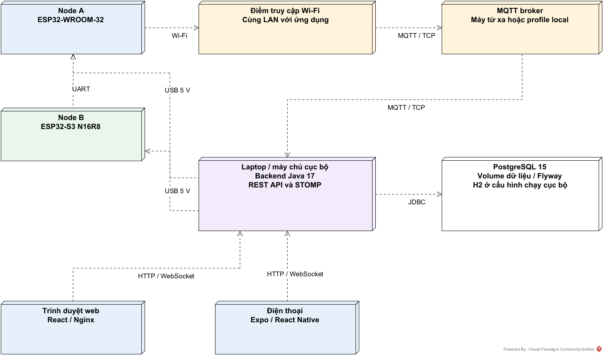

Hệ thống có hai cấu hình triển khai. Cấu hình cục bộ chạy backend và H2 file trên laptop, phù hợp với thử nghiệm và trình diễn. Cấu hình Docker tổ chức backend, PostgreSQL và Nginx thành các dịch vụ riêng [9]. Vị trí triển khai của backend, cơ sở dữ liệu và broker được xác định độc lập; mô hình cục bộ có thể sử dụng broker từ xa.

Quá trình vận hành bắt đầu từ cấp nguồn cho hai node và khởi chạy backend, cơ sở dữ liệu cùng kết nối broker. Người dùng đăng nhập web hoặc mobile, chọn xe rồi theo dõi dữ liệu, cảnh báo và gửi lệnh. Mật khẩu Wi-Fi, khóa JWT và thông tin xác thực dịch vụ được tách khỏi mã nguồn, cung cấp qua tệp cấu hình riêng hoặc biến môi trường.

Giao diện chủ xe tập trung vào chế độ bảo vệ, tốc độ, vị trí, cảnh báo và kết quả lệnh. Các thao tác sử dụng tên tiếng Việt. Mã giao thức, dữ liệu cảm biến chi tiết và công cụ mô phỏng nằm trong khu Chẩn đoán & thử nghiệm. Khi GPS mất định vị, màn hình thông báo tình trạng để người dùng nhận biết.

Ứng dụng di động được xây dựng bằng Expo/React Native và dùng chung backend với web [10]. Người dùng có thể đăng nhập, chọn xe, xem tổng quan, bản đồ, điều khiển, cảnh báo và lịch sử. Chức năng phụ thuộc phần cứng điện thoại như camera, bản đồ và thông báo đẩy được triển khai theo khả năng của nền tảng native; phạm vi kiểm thử được trình bày ở mục 15.

## 14.1. Tổ chức môi trường chạy

Docker Compose tổ chức PostgreSQL, backend và frontend trong mạng nội bộ `guardian-net`. PostgreSQL có volume dữ liệu và healthcheck; backend phụ thuộc database ở trạng thái sẵn sàng. Backend được đóng gói bằng Maven/Java 17 rồi chạy trong ảnh JRE, nhận cấu hình database, JWT, broker và dịch vụ thông báo qua biến môi trường.

Nginx phục vụ ứng dụng React, chuyển `/api/` tới backend và cấu hình nâng cấp WebSocket cho `/ws`. Nhờ đó trình duyệt có thể dùng cùng origin cho tài nguyên giao diện, REST và realtime. `try_files` đưa đường dẫn màn hình về `index.html`, hỗ trợ tải lại ở các trang con của ứng dụng một trang.

Broker Mosquitto cục bộ thuộc profile `local-broker`; cấu hình mặc định của backend vẫn có thể chọn broker từ xa. Bộ kết nối Paho dùng clean session, keepalive 30 s và timeout kết nối 3 s; vòng thử lại mỗi 5 s chịu trách nhiệm reconnect và đăng ký lại topic. Việc đặt broker ở xa không tự chuyển database và backend ra cloud.

Trong cấu hình cục bộ, profile H2 hỗ trợ chạy backend độc lập; launcher mobile có thể chọn H2 file để giữ dữ liệu giữa các lần chạy. Điện thoại gọi backend qua IPv4 LAN phù hợp, vì `localhost` trên điện thoại chỉ chính điện thoại đó. Expo/Metro phục vụ việc chạy ứng dụng trong môi trường phát triển; đường dữ liệu và điều khiển nghiệp vụ vẫn đi qua API, STOMP và MQTT của hệ thống.

## 14.2. Kiến trúc ứng dụng web và di động

Web và mobile là hai cách truy cập vào cùng hệ thống quản lý xe. Chúng dùng chung tài khoản, danh sách thiết bị, quyền trên xe, lịch sử và hợp đồng sự kiện của backend. Người dùng có thể quan sát xe trên một giao diện và tiếp tục thao tác trên giao diện còn lại mà không phải thiết lập một nguồn dữ liệu độc lập. Quyết định cho phép điều khiển vẫn thuộc backend và firmware; ứng dụng tiếp nhận thao tác, hiển thị trạng thái và giải thích kết quả.

Ứng dụng web sử dụng React, React Router và Vite. Cấu trúc được chia thành trang, thành phần dùng lại, lớp gọi API và lớp quản lý dữ liệu thời gian thực. `AuthProvider` giữ trạng thái đăng nhập; `DeviceProvider` cung cấp xe được chọn, cảm biến, cảnh báo, lệnh và thống kê phiên cho các trang. Khung giao diện chứa thanh điều hướng và bộ chọn xe, giúp các màn hình cùng làm việc trên một ngữ cảnh thiết bị. Trang phân tích và chẩn đoán được nạp khi truy cập, thay vì đưa toàn bộ chức năng vào lần tải đầu.

Ứng dụng di động sử dụng React Native, Expo và Expo Router. Các màn hình được tổ chức thành nhóm xác thực và nhóm đã đăng nhập. Thanh tab cung cấp năm đường vào chính: Tổng quan, Vị trí, Bảo vệ, Cảnh báo và Xe của tôi. Những thao tác như xem lịch sử, chỉnh thông tin hoặc kích hoạt thiết bị nằm ở các màn hình riêng. TypeScript mô tả cấu trúc dữ liệu API và sự kiện, giúp phát hiện sự không khớp kiểu khi thay đổi giao diện trao đổi với backend.

Trên mobile, `GuardianProvider` phối hợp với TanStack Query để quản lý dữ liệu từ server. Khóa truy vấn bao gồm người dùng và thiết bị, nên dữ liệu của xe hoặc tài khoản này không được sử dụng như kết quả của ngữ cảnh khác. Xe đang chọn được lưu theo người dùng bằng AsyncStorage. Khi đăng xuất, bộ nhớ truy vấn được xóa cùng phiên đăng nhập; khi đăng nhập lại, ứng dụng tải dữ liệu trong phạm vi quyền của tài khoản mới.

## 14.3. Đăng nhập, duy trì phiên và kết nối realtime

Lớp API tự gắn access token vào yêu cầu HTTP. Khi nhận lỗi hết phiên, client sử dụng refresh token để xin token mới rồi thực hiện lại yêu cầu theo cơ chế giới hạn số lần thử. Nhiều yêu cầu cùng phát sinh không tạo nhiều lượt refresh song song: chúng dùng chung một lời gọi đang xử lý. Cách tổ chức này hạn chế xung đột khi dashboard đồng thời tải danh sách xe, bản tin gần nhất, cảnh báo và lịch sử.

Web lưu thông tin phiên trong bộ nhớ trình duyệt. Mobile sử dụng lớp lưu trữ có triển khai theo nền tảng và quản lý một số thế hệ phiên. Nếu người dùng đã đăng xuất hoặc đổi tài khoản trong khi lời gọi cũ đang chờ, phản hồi thuộc thế hệ trước không được khôi phục phiên. Các lỗi xác thực được phân biệt với mất mạng tạm thời để tránh xóa phiên chỉ vì một lần không kết nối được server.

Kết nối STOMP gửi access token trong phần CONNECT và đăng ký kênh cá nhân `/user/queue/events`. Hai ứng dụng xử lý các nhóm sự kiện DEVICE, TELEMETRY, ALERT, COMMAND, WHEEL_SESSION và ACCESS_REMOVED. Client đặt chu kỳ thử kết nối lại 2 s, thời gian chờ kết nối 8 s và heartbeat STOMP hai chiều 10 s. Trước khi token hết hạn, kết nối được thiết lập lại với token hợp lệ. Đây là cơ chế duy trì phiên ứng dụng; nó độc lập với heartbeat UART giữa hai node.

## 14.4. Đồng bộ trạng thái và xử lý dữ liệu cũ

Ứng dụng sử dụng REST để lấy trạng thái ban đầu, sau đó hợp nhất sự kiện realtime vào bộ dữ liệu đang hiển thị. Ví dụ, khi mở xe, client tải bản tin cảm biến gần nhất, lịch sử lệnh và phiên bánh. Bản tin mới qua STOMP cập nhật những thành phần tương ứng mà không yêu cầu tải lại toàn bộ trang. Khi socket mất, ứng dụng lấy lại dữ liệu bằng REST với chu kỳ 5 s; mobile chỉ thực hiện cơ chế này khi đang ở trạng thái foreground.

Một vấn đề của luồng kết hợp là phản hồi HTTP có thể đến sau sự kiện mới hơn. Nếu ghi đè toàn bộ dữ liệu bằng phản hồi chậm, giao diện có thể đưa lệnh đã thực hiện trở lại trạng thái đang chờ hoặc khôi phục quyền vừa bị thu hồi. Web và mobile theo dõi phiên bản thay đổi của từng nhóm dữ liệu. Kết quả REST được hợp nhất theo định danh, trạng thái và phiên bản, thay vì luôn thay thế dữ liệu đang có.

Lệnh được liên kết bằng `cmdId`; phản hồi PENDING cũ không ghi đè EXECUTED hoặc REJECTED. Phép đo được gộp theo `readingId`, sắp xếp theo thời gian và giới hạn chuỗi trực tiếp ở 300 mẫu. Phiên bánh được kiểm theo định danh phiên và sequence; số đếm giảm do một phiên mới được phân biệt với bản tin cũ của cùng phiên. Khi nhận ACCESS_REMOVED, dữ liệu xe liên quan được loại khỏi danh sách, phép đo, cảnh báo, lệnh và thống kê; phản hồi cũ không được đưa dữ liệu đó trở lại.

Độ mới không chỉ phụ thuộc thời điểm vừa nhận một phản hồi. Giao diện tính tuổi bản tin theo đồng hồ cục bộ và trạng thái thiết bị. Mẫu quá 5 s không tiếp tục được biểu diễn như dữ liệu cảm biến đang hợp lệ. Với GPS, tuổi mẫu GPS được cộng thêm thời gian đã trôi qua từ lúc nhận. Vì vậy, khi nguồn ngừng cập nhật, giao diện tự chuyển trạng thái dù socket chưa đóng. Tốc độ bằng 0 hợp lệ cũng được phân biệt với không có tốc độ hợp lệ.

## 14.5. Các màn hình trên web

**Tổng quan.** Dashboard đặt trạng thái bảo vệ, tốc độ và tình trạng kết nối ở vị trí dễ quan sát. Người dùng chọn xe trên thanh đầu trang, xem dữ liệu gần nhất rồi thực hiện thao tác phù hợp. Khối điều khiển không tự báo thành công ngay sau HTTP; kết quả được cập nhật từ trạng thái lệnh. Phiên bánh cho biết quãng đường, số vòng, tốc độ cao nhất và thời gian của phiên RAM, giúp liên hệ chuyển động trên mô hình với dữ liệu ứng dụng.

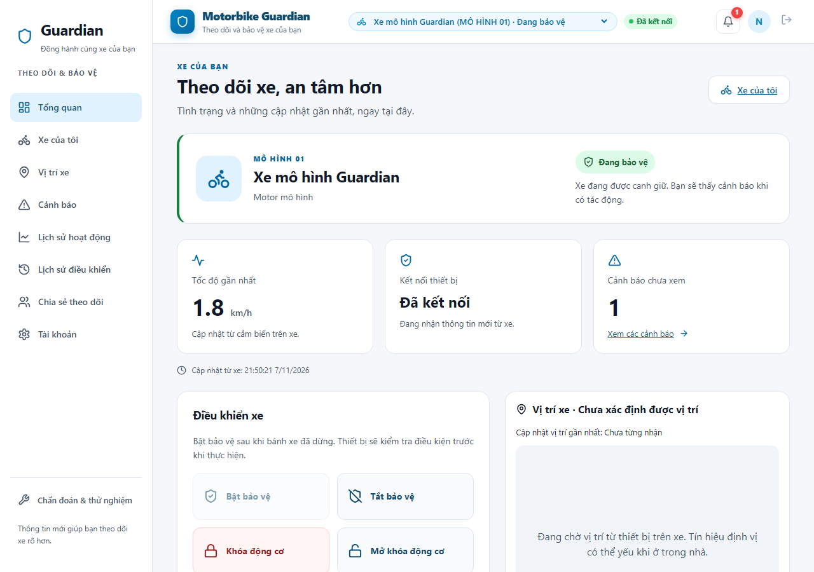

**Danh sách xe.** Trang Xe của tôi tập hợp các xe thuộc quyền sở hữu hoặc quyền theo dõi. Mỗi xe có tên, thông tin mô tả, trạng thái và các thao tác theo quyền. Khi sửa tên hoặc thông tin xe, biểu mẫu giữ phần người dùng đang nhập nếu có cập nhật realtime đi tới. Dữ liệu mô tả được gửi riêng với các ngưỡng mô phỏng, tránh vô tình thay đổi cấu hình không hiển thị trong biểu mẫu.

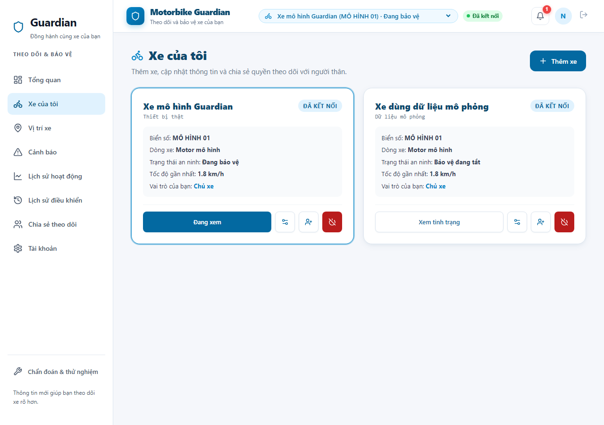

**Vị trí xe.** Trang vị trí phân biệt ba tình huống: chưa nhận vị trí, vị trí đang cập nhật và vị trí cuối đã biết. Nếu chưa có tọa độ hợp lệ, giao diện giải thích đang chờ dữ liệu từ thiết bị. Nếu có vị trí cũ, trạng thái cho biết đây không phải vị trí hiện tại. Ảnh minh họa trong báo cáo thể hiện nhánh chờ vị trí; nó không được dùng làm bằng chứng module đã định vị hoặc bản đồ nền đã tải thành công.

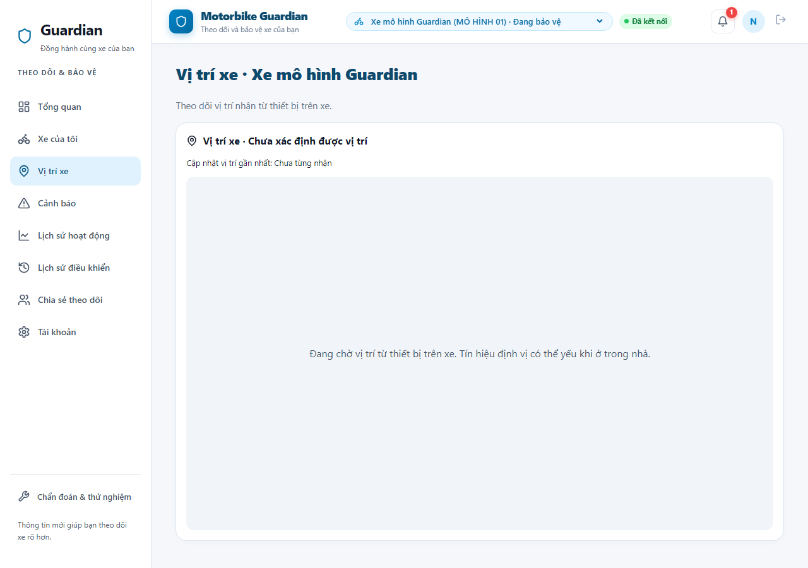

**Cảnh báo.** Trang cảnh báo nhóm thông tin theo mức độ và trạng thái xử lý. Nội dung hiển thị loại bất thường, xe liên quan, thời điểm nhận và hành động xử lý. Người có quyền đọc có thể xác nhận đã xem; thao tác xử lý hoàn tất phụ thuộc quyền trên xe. Bộ lọc cho phép tách cảnh báo chưa xử lý, đã xem và đã giải quyết, hỗ trợ theo dõi một sự kiện từ lúc xuất hiện đến lúc được kiểm tra.

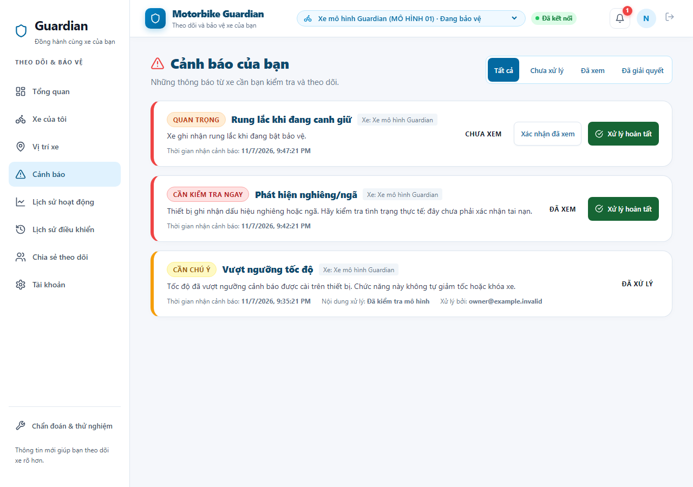

**Lịch sử điều khiển.** Mỗi yêu cầu được trình bày với loại lệnh, người gửi, trạng thái, lý do từ chối và thời điểm phản hồi. Hai yêu cầu cùng là khóa động cơ có thể có kết quả khác nhau do điều kiện bánh dừng hoặc tuổi mẫu tại firmware. Việc giữ lịch sử giúp người dùng xác định lệnh nào được thực hiện và lệnh nào cần kiểm tra lại điều kiện, thay vì chỉ nhìn trạng thái cuối cùng của xe.

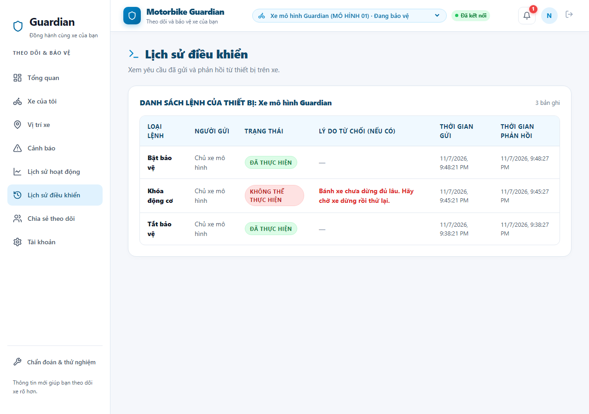

**Lịch sử hoạt động.** Người dùng chọn khoảng 1 giờ, 24 giờ hoặc 7 ngày để xem diễn biến tốc độ và các thống kê trong tập dữ liệu trả về. Web giới hạn tối đa 5.000 bản ghi cho một khoảng tra cứu. Biểu đồ dùng giá trị hợp lệ; dữ liệu thiếu không được nối thành một số đo giả. Chức năng tải bảng dữ liệu sử dụng cùng phạm vi thời gian và quyền truy cập, hỗ trợ đối chiếu với nhật ký thử nghiệm.

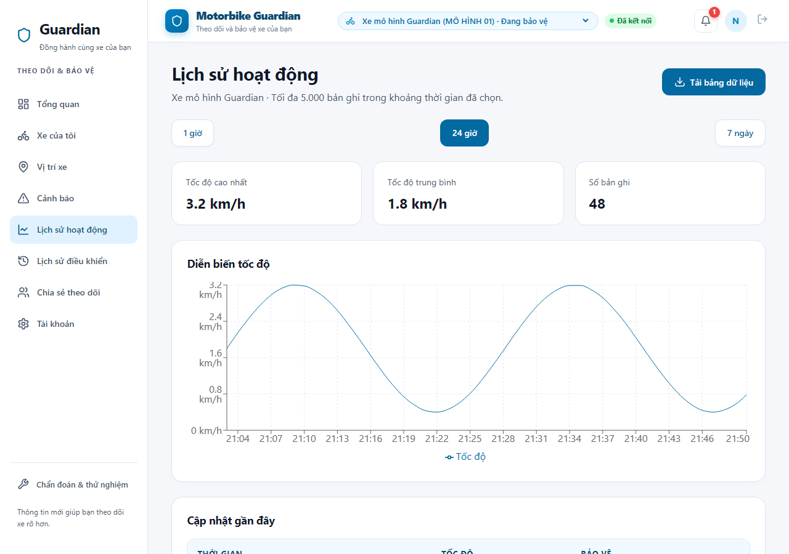


## 14.6. Các màn hình trên mobile

**Tổng quan và chọn xe.** Mobile ưu tiên các thẻ lớn để đọc nhanh trạng thái xe, tốc độ và thời điểm cập nhật. Bộ chọn xe giữ ngữ cảnh nhất quán giữa các tab. Trang Xe của tôi cho phép chọn thiết bị hoặc đi đến thông tin chi tiết, thay vì phải nhập lại UUID tại mỗi chức năng. Khi chọn xe mô phỏng, giao diện thể hiện nguồn dữ liệu để người dùng không nhầm với kết quả từ mạch.

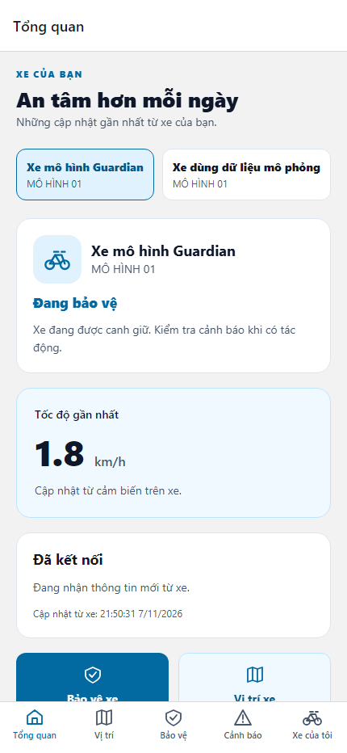

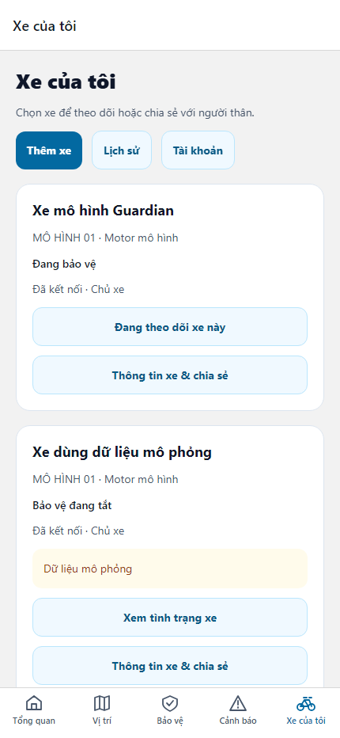

**Vị trí.** Logic chọn vị trí và giải thích độ mới được dùng thống nhất với các phần còn lại. Triển khai native sử dụng thành phần bản đồ theo nền tảng; bản Expo web của dự án hiển thị tọa độ và lời hướng dẫn sử dụng ứng dụng điện thoại để xem bản đồ đầy đủ. Hình chụp mobile trong báo cáo là bản web chạy ở kích thước điện thoại, phản ánh đúng cách hiển thị tọa độ này.

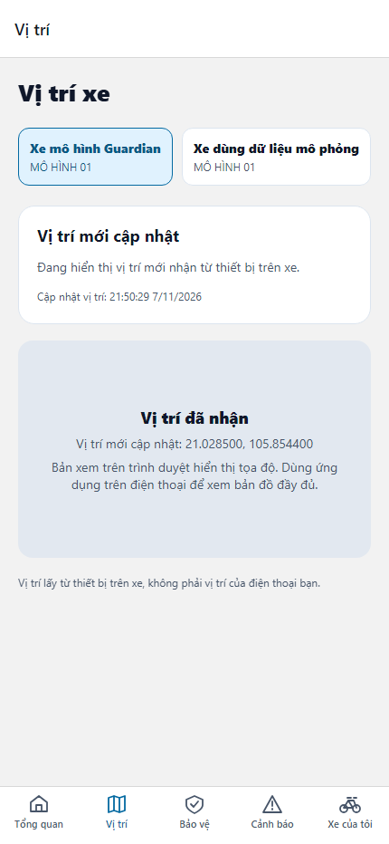

**Bảo vệ và điều khiển.** Tab Bảo vệ tập hợp bật/tắt bảo vệ, khóa/mở khóa và bật/tắt còi. Trạng thái yêu cầu được trình bày ngay dưới khu thao tác. Lệnh khóa sử dụng bước xác nhận theo luồng ứng dụng, còn backend và firmware tiếp tục kiểm quyền và điều kiện thiết bị. Cảnh báo tốc độ được giải thích là thông báo cần theo dõi, không đồng nghĩa với tự giảm tốc độ motor.

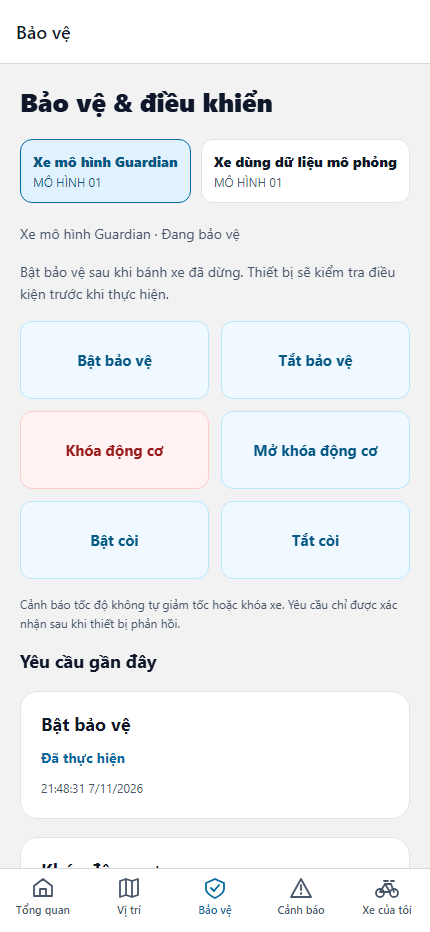

**Cảnh báo và lịch sử.** Mobile cho phép đọc và xử lý cảnh báo trong ngữ cảnh xe được cấp quyền. Trang lịch sử kết hợp biểu đồ, nút tải dữ liệu và các lệnh gần đây để hỗ trợ đối chiếu thao tác với dữ liệu. Đồ thị nhỏ sử dụng tối đa 40 điểm được lấy mẫu từ chuỗi hợp lệ nhằm giữ khả năng đọc trên màn hình hẹp; giới hạn tra cứu vẫn là 5.000 bản ghi. Giá trị thấp nhất/cao nhất trong khối đồ thị được tính trên chuỗi đã lấy mẫu, còn bảng dữ liệu xuất giữ phạm vi tra cứu theo API.

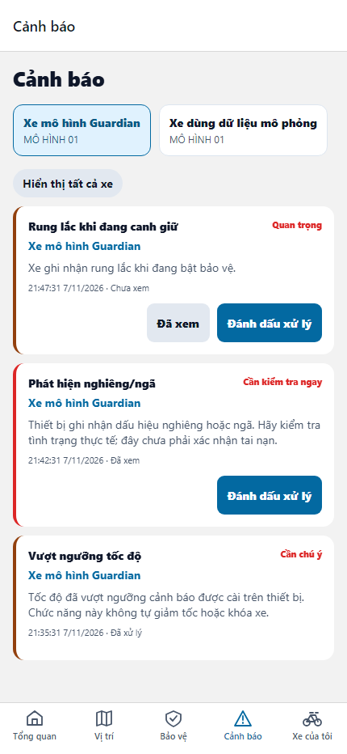

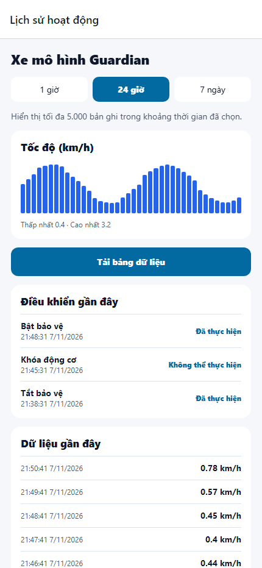


## 14.7. Tách trải nghiệm người dùng khỏi công cụ chẩn đoán

Tên thao tác và kết quả được diễn đạt bằng tiếng Việt, còn mã giao thức, định danh, cờ dữ liệu và công cụ mô phỏng được đặt trong khu Chẩn đoán & thử nghiệm. Cách bố trí giúp chủ xe tập trung vào tình trạng và hành động, đồng thời người phát triển vẫn có thông tin để đối chiếu UART/MQTT/API. Viewer không được mở công cụ thử; quyền giao diện bổ sung cho kiểm quyền tại backend, không thay thế nó.

Ảnh web và mobile được chụp trực tiếp từ các bản build của dự án với bộ dữ liệu REST/STOMP kiểm soát. Tọa độ, lịch sử tốc độ, cảnh báo và kết quả lệnh trong bộ ảnh là dữ liệu minh họa. Các ảnh mô tả màn hình và cách diễn giải dữ liệu, không xác nhận một phiên cảm biến, push nền hoặc bản đồ native trên điện thoại đã được nghiệm thu.

# 15. KIỂM THỬ VÀ ĐÁNH GIÁ

## 15.1. Phương pháp và kết quả kiểm thử

Hệ thống được kiểm thử theo từng lớp: logic firmware, dịch vụ backend, giao diện và tích hợp. Mỗi nhóm kiểm tra tập trung vào một phạm vi, từ xử lý mẫu đo đến phân quyền và phản hồi lệnh. Kết quả được tổng hợp riêng theo môi trường để tránh đồng nhất kiểm thử mô phỏng với vận hành phần cứng.

**Bảng 14. Kết quả kiểm thử và phạm vi.**

| Bộ kiểm | Kết quả | Môi trường kiểm thử |
|---|---|---|
| Backend | 24 ca đạt, không lỗi | Surefire: 1 kiểm tra migration, 21 realtime, 2 push |
| Logic web | 17 ca đạt | Trạng thái, độ mới dữ liệu, realtime và phiên bánh |
| Logic mobile | 43 ca thuộc 11 nhóm đạt | Kiểm tra logic; hồ sơ kèm kết quả kiểm tra kiểu dữ liệu và xuất ứng dụng |
| Giao diện người dùng và chẩn đoán | 34 kiểm tra đạt | Trình duyệt với bộ dữ liệu REST/STOMP kiểm soát |
| Tích hợp backend–mobile web | 15 kiểm tra đạt | Spring Boot/H2, thiết bị MQTT và dịch vụ push giả lập |
| Firmware | Kiểm thử logic và biên dịch đạt theo hồ sơ | Parser, Hall và phiên bánh trên máy tính |
| PostgreSQL/Docker/Nginx | Kiểm tra vận hành cơ bản đạt | Kiểm tra khởi động và truy cập; phạm vi này không bao gồm mọi migration trên PostgreSQL |

Kiểm thử bảo mật tập trung vào truy cập xe trái quyền và token không hợp lệ. Các ca tích hợp kiểm tra việc chặn Viewer điều khiển, tách dữ liệu mô phỏng khỏi xe thật, phản hồi từ chối lệnh, thu hồi quyền, thay đổi trạng thái GPS và lấy dữ liệu qua REST khi mất WebSocket. Phần thông báo đẩy được thử với dịch vụ HTTP giả lập; kết quả này không xác nhận điện thoại nhận được thông báo khi ứng dụng chạy nền.

## 15.2. Kiểm thử theo mục tiêu

**Bảng 15. Kịch bản trọng tâm và mức bằng chứng.**

| Kịch bản | Kết quả mong đợi | Căn cứ đánh giá |
|---|---|---|
| Bật bảo vệ, tạo rung/bánh quay | Sự kiện, trạng thái và lịch sử đồng nhất | Kiểm thử logic và xác nhận vận hành của người phụ trách phần cứng |
| Nghiêng mô hình đủ thời gian | Phát cảnh báo dấu hiệu ngã | Quy tắc trong mã nguồn, kiểm thử logic và hồ sơ vận hành; không sử dụng tập tai nạn thực |
| GPS mất fix trong nhà | Báo chưa định vị/vị trí cũ, không tạo 0,0 | Nhật ký NO_FIX; trạng thái ứng dụng được kiểm bằng bộ giả lập |
| Gửi LOCK khi bánh quay / dữ liệu cũ | REJECTED và đúng lý do | Nhật ký Node A và kiểm thử điều khiển |
| Viewer gọi REST điều khiển trực tiếp | Backend từ chối, không phát tác động | Backend/tích hợp kiểm quyền |
| Mất WebSocket rồi nối lại | Khôi phục trạng thái gần nhất, không bị dữ liệu cũ ghi đè | Kiểm thử logic và tích hợp cục bộ |

Về phần cứng, người phụ trách xác nhận MPU, relay, motor và nguồn hoạt động, GPS lấy được vị trí ngoài trời. Nhật ký GPS lưu trong bộ dữ liệu báo cáo chỉ ghi nhận trạng thái NO_FIX, nên kết quả không bao gồm sai số tọa độ hoặc thời gian bắt định vị. Ảnh ứng dụng minh họa giao diện bằng dữ liệu kiểm thử có kiểm soát; hình mạch dùng để mô tả các thành phần.

## 15.3. Hiệu năng và giới hạn phép đo

Một lượt thử trên Docker ghi nhận 125 ms từ bộ mô phỏng đến giao diện. Giá trị này phản ánh riêng lượt thử phần mềm đó, chưa đại diện độ trễ từ cảm biến đến ứng dụng hoặc phân vị p95. Chu kỳ lấy mẫu 50 ms, gửi UART 500 ms và MQTT khoảng 1 s là các tham số thiết kế.

Phạm vi đánh giá định lượng tập trung vào kiểm thử chức năng và một số quan sát độ trễ. Hồ sơ chưa đủ để kết luận về tỷ lệ mất bản tin, độ bền chạy lâu, dòng tiêu thụ hoặc độ chính xác phát hiện ngã trên xe thực tế. Kiểm thử logic và bản web của ứng dụng di động cũng không thay thế kết quả trên điện thoại native.

## 15.4. Đánh giá theo luồng đầu cuối

Đối với giám sát, điểm đầu của luồng là mẫu đo hoặc bản tin giả lập đã xác định nguồn. Kết quả được kiểm ở các bước: backend chấp nhận đúng thiết bị, lưu phép đo với đơn vị và tính hợp lệ, phát sự kiện tới đúng người dùng và cập nhật giao diện. Một màn hình hiển thị tốc độ chỉ xác nhận riêng bước trình bày; hồ sơ tích hợp mới liên kết được việc nhận MQTT với cơ sở dữ liệu và ứng dụng.

Đối với điều khiển, tiêu chí được tách thành kiểm quyền, phát lệnh, xử lý firmware và lưu ACK. Các trường hợp từ chối có giá trị kiểm thử tương đương trường hợp thành công vì chúng thể hiện điều kiện an toàn có tác dụng. Ví dụ, lệnh LOCK gửi khi bánh đang quay phải tạo phản hồi từ chối; giao diện giải thích lý do thay vì báo đã khóa. Thử nghiệm dùng thiết bị giả lập kiểm được đường lệnh và hợp đồng phản hồi, còn tiếp điểm relay và motor cần được quan sát trên mạch.

Đối với dữ liệu cũ, bộ kiểm tạo các chuyển đổi có chủ đích: mẫu hợp lệ rồi ngừng cập nhật, GPS có vị trí rồi mất hiệu lực, WebSocket ngắt trong khi REST còn hoạt động. Kết quả được quan sát ở trạng thái sử dụng dữ liệu và cách giao diện phục hồi. Mục tiêu không phải giữ một con số trên màn hình bằng mọi cách, mà là giữ đúng ý nghĩa của dữ liệu khi điều kiện kết nối thay đổi.

## 15.5. Tính nhất quán và khả năng truy vết

Các kiểm thử dùng định danh thiết bị và mã lệnh để liên kết thông tin giữa các tầng. Trong một phép kiểm điều khiển, cmd_id trong ACK phải khớp bản ghi command và đúng xe. readingId định danh mẫu đã lưu, không phải mã chống trùng bản tin MQTT từ thiết bị: mỗi lượt tiếp nhận telemetry có thể tạo một bản ghi mới. Cảnh báo dùng source_alert_id, lệnh dùng cmd_id, còn phiên bánh dùng session và sequence để nhận biết bản lặp trong phạm vi từng luồng. Khi kiểm realtime, thời điểm yêu cầu REST và phiên bản trạng thái được xem xét để tránh phản hồi cũ làm mất sự kiện mới.

# 16. CHỨC NĂNG NÂNG CAO

## 16.1. Theo dõi bánh, phiên thống kê và cảnh báo tốc độ

WheelActivityMonitor tại Node A dùng bộ đếm xung tích lũy, thời gian nguồn và boot_id của Node B. Khi nguồn vừa khởi động lại, monitor tạo mốc bộ đếm mới thay vì cộng phần chênh sai. Với cùng nguồn, số xung tăng được tính bằng phép trừ không dấu để xử lý vòng đếm. Mẫu có thời gian đi lùi hoặc số xung vượt khả năng bộ lọc 10 ms bị từ chối. Bộ đếm và tốc độ cũng phải thuộc các thời điểm không lệch nhau quá 1.500 ms.

Trong ARMED, monitor theo dõi số xung trong cửa sổ 3 s. Đạt ba xung sẽ phát WHEEL_MOVEMENT_WHILE_ARMED và chuyển trạng thái sang ALARM. Bộ đếm bảo vệ được làm mới khi thay đổi trạng thái ARMED; mỗi lần canh giữ chỉ phát sự kiện này một lần theo cờ đánh dấu. ALARM kéo dài ít nhất 15 s có thể chuyển THEFT_LOCK, nhưng vẫn phải thỏa điều kiện khóa tại thời điểm chuyển.

Phiên RAM tích lũy số xung, quãng đường, tốc độ lớn nhất và thời gian chuyển động. Quãng đường bằng số xung nhân chu vi chia số xung/vòng. Thời gian chuyển động được cộng theo khoảng mẫu bộ đếm có xung tăng và còn đủ mới; đây là thống kê theo mẫu, không phải phép đo từng microsecond motor chạy. Reset phiên tăng generation và xóa thống kê, nhưng không xóa cơ chế bảo vệ hoặc trạng thái quá tốc độ.

Cảnh báo tốc độ yêu cầu mẫu hợp lệ vượt 2 km/h liên tục theo thời gian nguồn ít nhất 2 s. Mẫu lặp cùng timestamp không được dùng để kéo dài điều kiện. Sau cảnh báo, tốc độ phải giảm xuống không quá 1,5 km/h ít nhất 2 s mới xóa trạng thái, tạo độ chênh ngưỡng bật/tắt 0,5 km/h. Sự kiện chỉ mang ý nghĩa cảnh báo; nó không điều khiển relay để giảm tốc motor.

## 16.2. Mô phỏng và phạm vi mở rộng

Realtime, lấy lại snapshot qua REST và bộ mô phỏng hỗ trợ kiểm tra dữ liệu thay đổi, kết nối gián đoạn và lệnh bị từ chối. Nguồn mô phỏng được tách khỏi dữ liệu phần cứng. OTA và AI nằm ngoài phạm vi; nhận biết dấu hiệu ngã dùng ngưỡng và thời gian.

# 17. HẠN CHẾ VÀ HƯỚNG PHÁT TRIỂN

**Bảng 16. Giới hạn và hướng phát triển.**

| Giới hạn của mô hình | Hướng phát triển |
|---|---|
| Kết nối từ xa phụ thuộc Wi-Fi | Bổ sung mạng di động cho phạm vi theo dõi hành trình |
| GPS suy giảm trong nhà; dữ liệu đánh giá vị trí còn hạn chế | Đánh giá vị trí ở nhiều môi trường, lưu chất lượng và tuổi mẫu |
| Nhận biết rung/ngã phụ thuộc góc lắp | Thu dữ liệu có nhãn, đánh giá báo đúng/báo nhầm và nghiên cứu mô hình học máy |
| Cấu hình MQTT chưa bao phủ đầy đủ xác thực riêng, ACL và TLS | Mở rộng quản lý danh tính, thu hồi và quyền topic tại broker |
| Thay đổi ngưỡng từ xa chỉ áp dụng cho mô phỏng | Bổ sung cấu hình cho thiết bị thật có phiên bản và xác nhận kết quả |
| Phiên bánh và bộ đệm lưu trong RAM | Bổ sung lưu trữ bền vững và khôi phục sau mất điện |
| Phạm vi kiểm thử điện thoại và phần cứng còn giới hạn | Mở rộng thử nghiệm native, độ ổn định nguồn và luồng cảm biến–ứng dụng |

Khi chuyển từ mô hình học phần sang sử dụng thực tế, các hướng mở rộng quan trọng là độ ổn định phần cứng, kết nối ngoài phạm vi Wi-Fi và bảo mật thiết bị. OTA hoặc AI là những khả năng mở rộng có thể nghiên cứu trên cơ sở dữ liệu thử nghiệm và tiêu chí đánh giá cụ thể.

# 18. KẾT LUẬN

Đồ án đã xây dựng Smart Motorbike Guardian với các thành phần cảm biến, xử lý tại biên, truyền thông, backend, cơ sở dữ liệu và ứng dụng web/mobile. Hệ thống hỗ trợ bảo vệ xe khi đỗ, theo dõi tốc độ và vị trí, cảnh báo dấu hiệu bất thường, quản lý quyền và lưu lịch sử điều khiển.

Kết quả kiểm thử thể hiện khả năng phối hợp giữa các tầng, đặc biệt trong cập nhật dữ liệu, phân quyền và phản hồi lệnh. Thiết kế cho phép theo dõi cả trường hợp vận hành bình thường lẫn mất kết nối, dữ liệu cũ và lệnh bị từ chối. Các kết quả đạt được đáp ứng phạm vi nghiên cứu của mô hình IoT trên breadboard; hiệu quả chống trộm và nhận biết tai nạn trong thực tế không thuộc kết luận kiểm định của đồ án.

<!-- PAGE -->

# 19. TÀI LIỆU THAM KHẢO

[1] Tài liệu học phần (2026). *Đề bài đồ án kết thúc học phần: IoT và ứng dụng*. Tài liệu yêu cầu và cấu trúc báo cáo, mục 8.2.

[2] Nhóm Smart Motorbike Guardian (2026). *Mã nguồn và hồ sơ kiểm thử*. https://github.com/hieupham03/smart-motorbike-guardian. Các thành phần và bộ dữ liệu đối chiếu được liệt kê trong Phụ lục.

[3] OASIS (2014). *MQTT Version 3.1.1*. https://docs.oasis-open.org/mqtt/mqtt/v3.1.1/os/mqtt-v3.1.1-os.html.

[4] Espressif Systems. *ESP-IDF FreeRTOS*. https://docs.espressif.com/projects/esp-idf/en/stable/esp32/api-reference/system/freertos_idf.html.

[5] Spring. *Password Storage*. https://docs.spring.io/spring-security/reference/features/authentication/password-storage.html.

[6] Spring. *STOMP Token Authentication*. https://docs.spring.io/spring-framework/reference/web/websocket/stomp/authentication-token-based.html.

[7] PostgreSQL. *Constraints*. https://www.postgresql.org/docs/15/ddl-constraints.html.

[8] Mikal Hart. *TinyGPSPlus*. https://github.com/mikalhart/TinyGPSPlus.

[9] Docker. *Compose application model*. https://docs.docker.com/compose/intro/compose-application-model/.

[10] Expo. *SDK Reference*. https://docs.expo.dev/versions/v58.0.0/.

[11] Espressif Systems. *ESP32-S3-WROOM-1/1U Datasheet*. https://documentation.espressif.com/esp32-s3-wroom-1_wroom-1u_datasheet_en.pdf.

[12] u-blox. *NEO-6 Data Sheet*. https://content.u-blox.com/sites/default/files/products/documents/NEO-6_DataSheet_%28GPS.G6-HW-09005%29.pdf.

[13] u-blox. *LEA-6/NEO-6/MAX-6 Hardware Integration Manual*. https://content.u-blox.com/sites/default/files/products/documents/LEA-NEO-MAX-6_HIM_%28UBX-14054794%29_1.pdf.

[14] Espressif Systems. *Hardware Schematic Checklist*. https://docs.espressif.com/projects/esp-hardware-design-guidelines/en/latest/esp32s3/schematic-checklist.html.

[15] u-blox. *u-blox6 Receiver Description Including Protocol Specification*. https://content.u-blox.com/sites/default/files/products/documents/u-blox6_ReceiverDescrProtSpec_%28GPS.G6-SW-10018%29_Public.pdf.

[16] Nick O'Leary. *PubSubClient: Limitations*. https://github.com/knolleary/pubsubclient.

[17] Espressif Systems. *Arduino-ESP32 Serial (UART)*. https://docs.espressif.com/projects/arduino-esp32/en/latest/api/serial.html.

[18] Spring. *Transaction-bound Events*. https://docs.spring.io/spring-framework/reference/data-access/transaction/event.html.

[19] OWASP. *Authorization Cheat Sheet*. https://cheatsheetseries.owasp.org/cheatsheets/Authorization_Cheat_Sheet.html.

[20] Eclipse Mosquitto. *mosquitto.conf manual*. https://mosquitto.org/man/mosquitto-conf-5.html.

[21] Bộ Công an (2025). *Triệt phá đường dây trộm cắp và tiêu thụ xe máy, mô tô trộm cắp xuyên quốc gia*. https://www.bocongan.gov.vn/bai-viet/triet-pha-duong-day-trom-cap-va-tieu-thu-xe-may-mo-to-trom-cap-xuyen-quoc-gia-1756880668.

[22] WHO. *Road traffic injuries*. https://www.who.int/news-room/fact-sheets/detail/road-traffic-injuries.

[23] Yamaha Motor Việt Nam. *Ứng dụng Y-Connect*. https://yamaha-motor.com.vn/yconnect/.

[24] Monimoto. *How Monimoto tracker works*. https://monimoto.com/how-monimoto-smart-tracker-works/.

<!-- PAGE -->

# 20. PHỤ LỤC

## 20.1. Dữ liệu và phiên bản để đối chiếu

**Bảng 17. Truy vết nội dung báo cáo.**

| Nội dung | Nguồn trong repository |
|---|---|
| Firmware, GPIO, ngưỡng | firmware/node_a_gateway/; firmware/node_b_sensor/; config/header tương ứng |
| Nguồn, relay và cảm biến | hardware/SO-DO-DAU-NOI-PHAN-CUNG.md |
| Backend và database | backend/src/main/java/com/guardian/; resources/db/migration/ |
| UI, realtime và quyền | frontend/src/; frontend/mobile/src/ |
| 34 UI / 15 tích hợp | docs/evidence/user-dev-ui/2026-11-01/ |
| Backend24 / mobile43 | backend/target/surefire-reports/; docs/../frontend/mobile/README.md |
| GPS và vận hành | docs/evidence/gps/; docs/RELEASE.md |
| Bản build/host firmware | docs/evidence/wheel-features-2026-10-20/; tests/firmware/ |

Mã firmware chính nằm trong thư mục firmware/; node_a/ và node_b/ là các bản sao dùng cho thao tác nạp. Các nguồn trong bảng truy vết liên kết phần mô tả thiết kế với mã triển khai và kết quả kiểm thử tương ứng.

## 20.2. Ví dụ phản hồi điều khiển

Ví dụ bản tin phản hồi khi thiết bị từ chối lệnh do bánh chưa dừng:

```json
{"cmd_id":"demo-command-id","result":"REJECTED","reason_if_failed":"SPEED_NOT_ZERO"}
```

Ứng dụng diễn giải kết quả thành thông báo dễ hiểu: không thể thực hiện lệnh khi bánh chưa dừng. Trường cmd_id liên kết bản tin với bản ghi backend và nhật ký xử lý của Node A. Giá trị trong ví dụ chỉ dùng minh họa cấu trúc bản tin.

## 20.3. Khu chẩn đoán

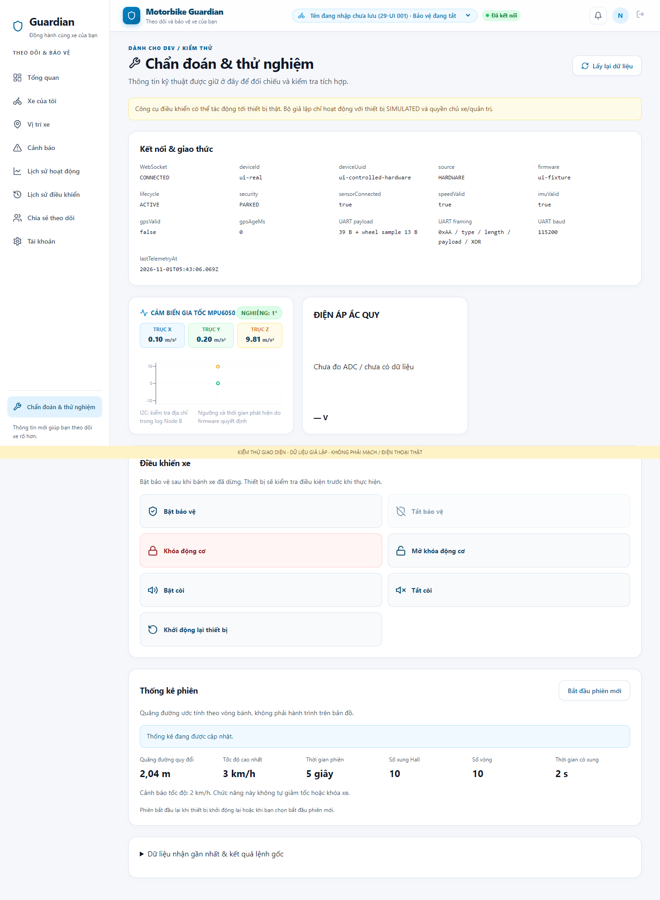

Khu chẩn đoán hỗ trợ đối chiếu trường dữ liệu và thử nguồn mô phỏng theo quyền. Phần này tách khỏi màn hình chủ xe để thao tác thường ngày tập trung vào tình trạng xe và hành động cần làm.

[^ai-content]: Công cụ AI hỗ trợ rà mã nguồn, tổ chức và biên tập nội dung báo cáo. Nhóm chịu trách nhiệm kiểm chứng, chỉnh sửa và giải thích nội dung sử dụng.

[^ai-image]: Công cụ image_gen hỗ trợ lược chú thích trên hình tham chiếu. Hình dùng để minh họa linh kiện, không thay sơ đồ chân và bảng kết nối. Các sơ đồ còn lại dựa trên cấu trúc mã nguồn; ảnh giao diện sử dụng dữ liệu kiểm thử có kiểm soát.
